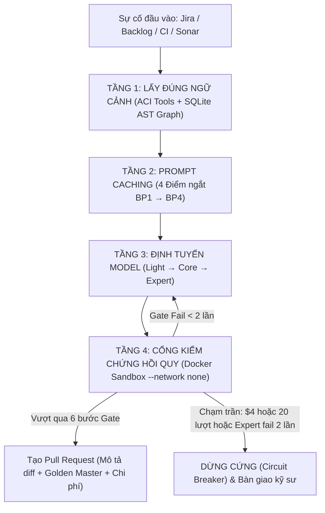

# Aegis Platform (`aegis-code`)

> **Agentic Code Maintenance Platform:** Nền tảng tự động hóa bảo trì mã nguồn bằng AI Agent — tiếp nhận sự cố, phân tích ngữ cảnh, sinh bản vá an toàn và tạo Pull Request đã qua kiểm chứng nghiêm ngặt, chờ kỹ sư phê duyệt.

[](https://www.rust-lang.org)
[]()
[]()

---

## 🎯 1. Bối Cảnh & Mục Tiêu Dự Án

### Bài toán thực tế
Trong các dự án phần mềm quy mô lớn, việc bảo trì (sửa lỗi sản xuất, fix CI failures, xử lý cảnh báo SonarQube) tiêu tốn hàng nghìn giờ kỹ sư mỗi năm (~2–3 FTEs). Quá trình thủ công này thường gây mệt mỏi về ngữ cảnh (context fatigue), dễ sinh lỗi hồi quy (regression) và làm chậm tiến độ phát triển tính năng mới.

### Tầm nhìn & Giải pháp
Aegis chuyển đổi quy trình bảo trì thủ công sang mô hình **Tự động hóa hướng tác tử (Agentic SDLC)**:
* AI Agent đảm nhận **80% khối lượng công việc lặp lại**: đọc hiểu ticket $\rightarrow$ định vị lỗi bằng đồ thị AST $\rightarrow$ viết test tái hiện $\rightarrow$ sinh bản vá $\rightarrow$ chạy toàn bộ test và Sonar trong sandbox $\rightarrow$ mở Pull Request hoàn chỉnh.
* **Nguyên tắc "Human-in-the-loop" bất di bất dịch:** Agent **tuyệt đối không bao giờ tự merge**. Toàn bộ quyền quyết định cuối cùng luôn thuộc về kỹ sư con người. Thời gian review của kỹ sư giảm từ 3–5 giờ xuống còn 5–10 phút mỗi issue.

### 3 Chỉ số KPI sống còn
| Chỉ số | Ngưỡng mục tiêu | Ý nghĩa đo lường |
| :--- | :---: | :--- |
| **Đúng** (Acceptance Rate) | $\ge 40\%$ | Tỉ lệ PR được kỹ sư chấp thuận merge với chỉnh sửa nhỏ ($\le 10$ dòng code). |
| **Rẻ** (Cost Efficiency) | $\le \$4 - \$8$ / issue | Chi phí API trung bình cho mỗi issue (bao gồm cả các ca thất bại và phụ phí vùng). |
| **An toàn** (Zero Regression) | $0\%$ lỗi hồi quy | Không bao giờ có PR làm vỡ test hiện có của dự án được phép gửi đến reviewer. |

---

## 🏛️ 2. Kiến Trúc Hệ Thống

Platform được xây dựng 100% bằng **Rust** theo cấu trúc Cargo Workspace ([ADR 0001](docs/adr/0001-platform-in-rust.md)), đảm bảo hiệu năng cao, an toàn bộ nhớ và đồng nhất ngôn ngữ với repo bảo trì mục tiêu.

### Sơ đồ luồng xử lý sự cố (4 Tầng kiểm soát)



### Chi tiết 4 Tầng kiểm soát cốt lõi
1. **Tầng 1 – Ngữ cảnh chuẩn xác (Context Engine):**
   * Tìm theo AST bằng tree-sitter của từng language profile. Prompt kèm một module map sinh từ code. Thiết kế còn có truy vấn đồ thị quan hệ (`CALLS`, `IMPORTS`, `TESTS`) qua Codebase-Memory MCP và language server (`rust-analyzer`, `basedpyright`…), nhưng phần này chưa nối vào code ([Thiết kế §3.2](docs/design/01-architecture-detail.md)).
   * Bộ công cụ ACI định lượng: Giới hạn mở đúng 100 dòng (SWE-agent standard), tìm kiếm tối đa 50 kết quả. Lệnh `edit` bắt buộc chạy qua linter kiểm tra cú pháp trước khi ghi lên đĩa.
   * **Batch History Collapse:** Khi context vượt $60\%$ window, nén các output quan sát cũ thành `[Observation collapsed]` để bảo vệ cache và context, nhưng bảo toàn nguyên vẹn suy nghĩ (reasoning) của model.
2. **Tầng 2 – Prompt Caching toán học:**
   * Cố định thứ tự 4 điểm ngắt: `BP1` (Tools) $\rightarrow$ `BP2` (System prompt, conventions) $\rightarrow$ `BP3` (Issue context, repro test) $\rightarrow$ `BP4` (Lịch sử hội thoại động).
   * Đảm bảo cấu trúc byte-stable (JSON key sorted, không chèn ngày giờ/session động vào BP1-BP2) để đạt **tỉ lệ đọc cache $\ge 70\%$** (tiết kiệm 90–95% chi phí input).
3. **Tầng 3 – Phân cấp Model & Circuit Breaker:**
   * **Light (`Haiku 5.5`):** Phân loại issue, tóm tắt log build/test, cắt ngắn stack trace.
   * **Core (`Sonnet 5.5`):** Tìm lỗi, viết test tái hiện, sinh bản vá.
   * **Expert (`Opus 5.5`):** Xử lý ca khó, lỗi kiến trúc hoặc trải trên $\ge 3$ files.
   * **Luật dừng kinh tế:** Dừng ngay lập tức nếu tổng chi phí $> \$4$ hoặc vượt 20 lượt gọi model.
4. **Tầng 4 – Cổng kiểm chứng 6 bước trong Docker:**
   * Format $\rightarrow$ Lint $\rightarrow$ Test tái hiện (chứng minh FAIL $\rightarrow$ PASS) $\rightarrow$ Test toàn bộ $\rightarrow$ Coverage $\rightarrow$ Sonar Quality Gate (bước Sonar chưa làm, #91). Lệnh của từng bước lấy từ language profile của repo (ví dụ Rust: `cargo fmt`, `cargo clippy`, `cargo llvm-cov`) — xem [ADR 0004](docs/adr/0004-multi-language-profiles.md).
   * **Kỹ thuật Golden Master:** Với code legacy chưa có test, agent viết test ghi nhận hành vi hiện tại trước khi sửa; mọi thay đổi kết quả bắt buộc phải khai báo trong mục *"Test được phép đổi kết quả"* của PR.

### Kiến trúc Dịch vụ Doanh nghiệp (Phase 2 Platform Service)
Theo [ADR 0003](docs/adr/0003-platform-service-architecture.md), hệ thống hướng tới:
* Single binary `aegis-server` (Axum) với các vai trò `--role api|worker|all`.
* Hàng đợi công việc giao dịch (Transactional Job Queue) trực tiếp trên **PostgreSQL** qua `SELECT ... FOR UPDATE SKIP LOCKED` (ACID, chống trùng, trừ ngân sách nguyên tử, không cần Redis/SQS).
* Giao diện Dashboard quản trị và review PR tinh gọn bằng server-rendered HTML (**Askama + htmx**), bảo mật với OIDC và AWS Secrets Manager.

### Rào giậu Bảo mật & Chủ quyền Dữ liệu
* **Chủ quyền Dữ liệu Nhật Bản (Japan Data Residency):** Cấu hình khách hàng (`customer-jp.toml`) định tuyến qua AWS Bedrock vùng `ap-northeast-1` (Tokyo/Osaka). Crate `aegis-provider` tích hợp sẵn guard `ModelPolicy::JapanOnly` chặn đứng mọi request không có tiền tố `jp.`.
* **Sandbox cách ly hoàn toàn mạng:** Container chạy `--network none`, không mount secret, file `.env` hay credentials.
* **Phòng thủ Indirect Prompt Injection:** Coi toàn bộ comment mã nguồn, file README và issue description là dữ liệu không tin cậy.

---

## ⚡ 3. Các Chức Năng Chính (Core Capabilities)

* 📥 **Tiếp nhận sự cố đa kênh:** Hỗ trợ nhận diện ticket lỗi từ Jira, Backlog, webhook sự kiện CI thất bại (GitHub Actions, GitLab CI) và cảnh báo tĩnh từ SonarQube.
* 🔍 **Tự động phân loại & Tóm tắt sự cố:** Model Light tự động phân tích stack trace, trích xuất crate/module khả nghi và trả về metadata có cấu trúc (`has_repro_info`, `suspected_crates`).
* 🧪 **Viết Test tái hiện độc lập:** Tự động tạo test case tái hiện lỗi và kiểm chứng trạng thái **FAIL** trước khi bắt tay vào sửa code.
* 🛠️ **Sinh bản vá có kiểm soát cú pháp:** Công cụ `edit` tự động chạy linter và kiểm tra cú pháp; từ chối ghi đè nếu bản vá gây lỗi biên dịch.
* 📦 **Gom nhóm cảnh báo Sonar hàng loạt (Batching & Integration):** Phân cụm hàng chục cảnh báo theo AST node hoặc đường truyền dữ liệu (tainted dataflow), chạy trên các nhánh song song và merge tuần tự vào nhánh `agent/integration-<batch-id>`.
* 🛡️ **Kiểm chứng hồi quy tự động:** Đảm bảo 100% test cũ của dự án vẫn pass và code mới đạt chuẩn Sonar way (coverage $\ge 80\%$, trùng lặp $\le 3\%$).
* 📝 **Mở Pull Request chuẩn chỉnh:** Tự động sinh mô tả PR gồm: nguyên nhân gốc, chi tiết từng đoạn sửa, bằng chứng test tái hiện, bảng kiểm chứng Gate, danh sách Golden Master và bảng kê chi phí token.
* 💰 **Hạch toán chi phí & Giám sát ngân sách thời gian thực:** Crate `aegis-ledger` ghi nhận chi tiết token, USD từng lượt gọi model/gate vào log JSON và DB, tự động ngắt nếu có nguy cơ vượt trần kinh tế.

---

## 📂 4. Hiện Trạng Cấu Trúc Mã Nguồn

```
crates/
├── aegis-provider/       # [✔ ĐÃ XONG] ModelProvider: Claude API & Bedrock jp. (35 tests pass)
├── aegis-orchestrator/   # [✔ ĐÃ XONG] Agent loop, session, batch collapse (23 tests pass)
├── aegis-router/         # [🟡 Đang làm #10] Phân cấp Light/Core/Expert, luật leo thang & dừng
├── aegis-aci/            # [🟡 Đang làm #7, #8] Bộ công cụ MCP thao tác code: search, open, edit
├── aegis-gate/           # [🟡 Đang làm #11] Runner điều phối chuỗi kiểm chứng 6 bước trong Docker
├── aegis-ledger/         # [🟡 Đang làm #9] Trait tính chi phí & ghi nhận ledger từng issue
├── aegis-pr/             # [🟡 Đang làm #15] Quản lý nhánh agent/<id> và sinh mô tả PR
├── aegis-sonar-batch/    # [⬜ Chưa làm #17] Gom cụm cảnh báo Sonar và merge integration branch (crate rỗng)
└── aegis-cli/            # [🟡 Đang làm] Binary CLI entrypoint chạy 1 issue hoặc 1 batch
```

---

## 🚀 5. Hướng Dẫn Bắt Đầu Nhanh

### Yêu cầu cài đặt
* Rust toolchain (1.80+)
* Docker (phục vụ chạy test trong sandbox cách ly)

### Kiểm thử mã nguồn
```bash
# Kiểm tra định dạng code
cargo fmt --check

# Kiểm tra linting với Clippy (toàn workspace và backend Bedrock)
cargo clippy --workspace --all-targets -- -D warnings
cargo clippy -p aegis-provider --all-targets --features bedrock -- -D warnings

# Chạy toàn bộ test suites
cargo test --workspace
cargo test -p aegis-provider --features bedrock
```

---

## 🗺️ 6. Lộ Trình Phát Triển

* **Phase 0 – Chuẩn bị:** Thiết lập CI repo, dựng Docker sandbox, đo build CI, gom bộ 30–50 issue ([Proposal §9](docs/design/00-proposal.md)).
* **Phase 1 – MVP / PoC:** Hoàn thiện các crate phần lõi và language profile Rust, Python; đo lường 3 KPI thực nghiệm trên một repo nội bộ mỗi ngôn ngữ ([ADR 0002](docs/adr/0002-full-platform-mvp-as-checkpoint.md)).
* **Phase 2 – Nền Tảng Dịch Vụ:** Profile TypeScript/JavaScript, Java, Go, C#/.NET; single binary `aegis-server` (Axum), PostgreSQL job queue, connectors (Jira/GitLab), Askama+htmx dashboard ([ADR 0003](docs/adr/0003-platform-service-architecture.md)).
* **Phase 3 – Mở Rộng:** Kỹ thuật định vị lỗi nâng cao SBFL, nén ngữ cảnh sâu (SWEzze/SaraCoder), thêm ngôn ngữ ngoài 6 profile ban đầu.

---

## 📖 7. Tài Liệu Tham Chiếu & Quy Ước

* [Proposal Dự Án](docs/design/00-proposal.md) (Tài liệu định hướng chuẩn cao nhất)
* [Chi Tiết Kỹ Thuật](docs/design/01-architecture-detail.md) (Đặc tả kỹ thuật phần lõi Phase 1)
* [Các Quyết Định Kiến Trúc (ADRs)](docs/adr/)
* [Quy Ước Phát Triển & Issue Workflow](CLAUDE.md) (Quy định nhánh, commit và pre-PR checks)
