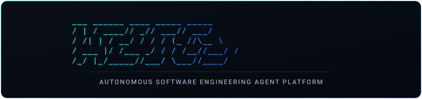
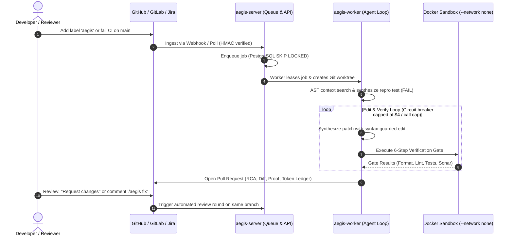
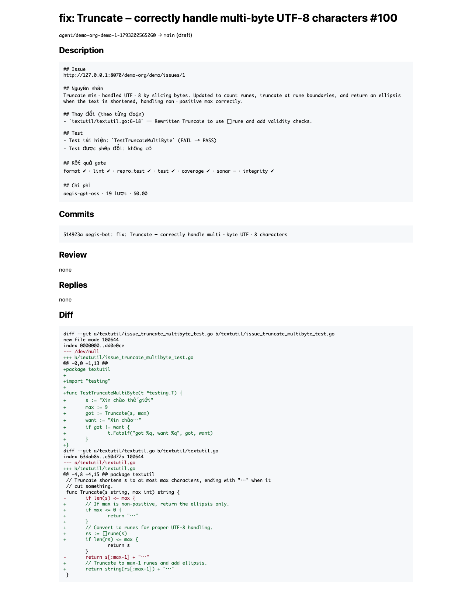
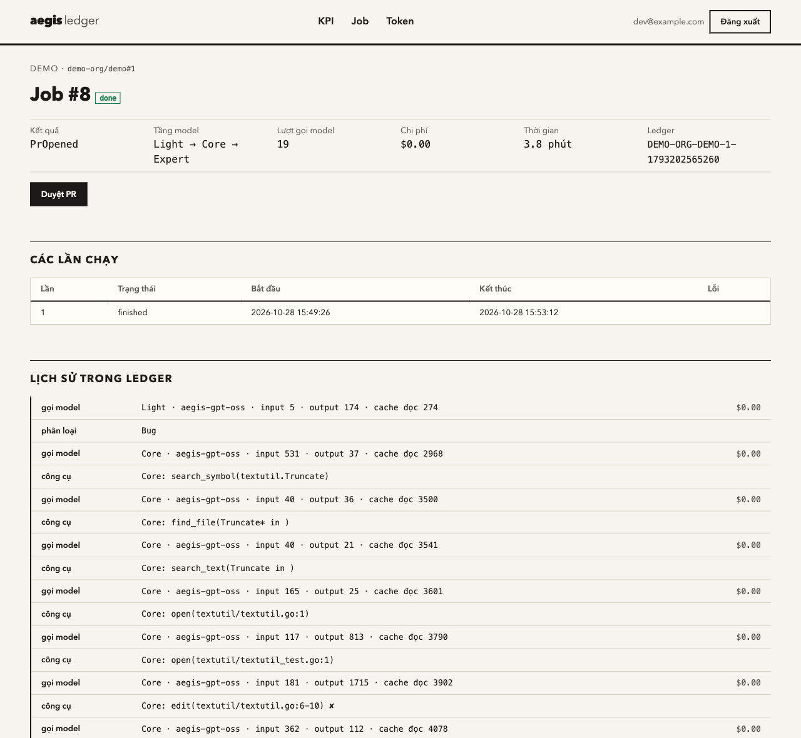
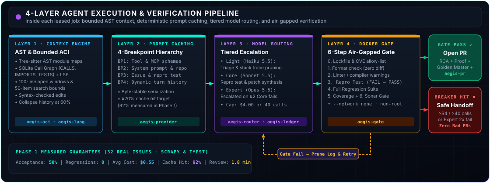
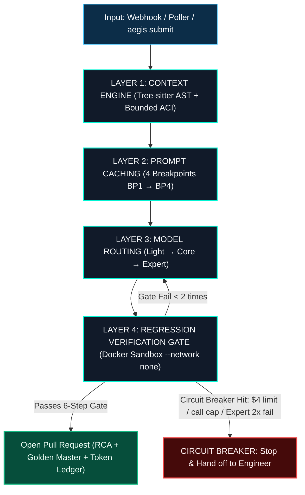

<p align="center">
  
</p>

# Aegis Platform (`aegis-code`)

> **Autonomous Code Maintenance Platform:** Agentic software maintenance powered by AI — ingests issues, localizes root causes via AST graphs, synthesizes verified patches, and opens high-quality Pull Requests for human review.

[](https://www.rust-lang.org)
[](LICENSE)
[]()
[](https://www.npmjs.com/package/@hoanghainh/aegis)
[]()
[]()

<p align="center">
  <a href="#-1-context--objectives">Context & KPIs</a> •
  <a href="#-2-how-it-works-end-to-end-workflow">How It Works</a> •
  <a href="#-3-quick-start--installation">Quick Start</a> •
  <a href="#-4-system-architecture">System Architecture</a> •
  <a href="#-5-deployment--operations">Deployment</a> •
  <a href="#-7-repository-structure">Crate Topology</a> •
  <a href="#-9-references--documentation">Docs & ADRs</a>
</p>

---

## 🎯 1. Context & Objectives

### The Problem
In enterprise software engineering, code maintenance (resolving production bugs, addressing CI test breakages, remediating SonarQube quality alerts) takes engineering time away from feature work every week. This manual, repetitive loop causes context fatigue, introduces unintended regressions, and delays core feature delivery.

### Vision & The Agentic SDLC
Aegis transforms manual maintenance into an **Agentic Software Development Life Cycle (SDLC)**:
* **Automates the Repetitive Steps:** Ingests tickets $\rightarrow$ locates root causes via AST relational graphs $\rightarrow$ synthesizes failing reproduction test cases $\rightarrow$ implements patches $\rightarrow$ rigorously validates against a 6-step isolated sandbox gate $\rightarrow$ publishes comprehensive Pull Requests.
* **Strict "Human-in-the-Loop" Principle:** Aegis **never merges autonomously**. Final approval and merge decisions always remain with human engineers. What is left for the engineer is the review: **1.8 minutes per PR** in the Phase 1 evaluation, against a target of 15 (see the caveats under the table below).

### Core KPIs: Targets and Measured Results
Thresholds are set in [ADR 0005](docs/adr/0005-kpi-thresholds-after-phase-1.md). "Measured" is the Phase 1 evaluation: 32 real, already-fixed issues from two open-source projects, scrapy (Python, 14) and typst (Rust, 18), with hidden tests ([eval/README.md](eval/README.md), [report](docs/measurements/2026-10-24-eval-kpi.md)).

| Metric | Target | Measured (Phase 1) | Description |
| :--- | :---: | :---: | :--- |
| **Acceptance Rate** | $\ge 40\%$ total, $\ge 35\%$ per language | **50%** (Python 64%, Rust 39%) | PRs a reviewer accepts with at most 10 lines edited. |
| **Zero Regression** | 0 | **0** | PRs that break an existing test and still reach a reviewer. |
| **Cost per Issue** | $\le \$4$ average | **$0.55** | Model spend per issue, failed runs included. A job is stopped at $4 or at its call cap: 40 model calls, 80 for Rust ([ADR 0014](docs/adr/0014-per-language-call-cap.md)). |
| **Review Time** | $\le 15$ min | **1.8 min** | Human time to judge one PR. |
| **Prompt Cache Reads** | $\ge 70\%$ | **92%** | Share of input tokens served from the prompt cache. |

Caveats: both projects are public, so models may have seen their fixes during training; Phase 1 reviewers could see hidden test results, which shortens review time. Both are re-measured on internal repositories during the pilot (#157, #158). For the four Phase 2 profiles (TypeScript, Java, Go, C#), the KPI run (#259, [report](docs/measurements/2026-11-10-new-profiles-kpi.md)) and Java rerun (#425, [report](docs/measurements/2026-11-11-java-rerun-kpi.md)) met the ≥ 35% threshold on TypeScript, Go, and Java (50%–100% under the #424 scoring rule), and C# reached 50% (4/8) after two prompt rules (#448, [report](docs/measurements/2026-11-13-csharp-prompt-rules.md)). In the same run, with a cap of 80 model calls, Rust (typst) reached 56% (10/18).

---

## 🔄 2. How It Works (End-to-End Workflow)



1. **Ingest:** Triggered automatically via GitHub/GitLab webhook (labels like `aegis`), polled tickets (Jira, Backlog), failed CI runs on `main`, or manually via `aegis submit`.
2. **Reproduce & Isolate:** The agent navigates the codebase using bounded AST tools, generates a minimal reproducing test, and confirms that it **FAILS** before making changes.
3. **Patch & Verify:** The agent edits code with syntax-safe linters and executes the 6-step gate inside an isolated Docker sandbox container (`--network none`).
4. **Human Review & Review Rounds:** The agent opens a PR detailing the root cause, verification evidence, and cost breakdown. If a reviewer requests changes or comments `/aegis fix`, the agent triggers a review round on the same branch without force-pushing.

### What You Get

Screenshots from a [local trial](docs/local-trial.md) run with a free local model (Ollama `gpt-oss:20b`), fixing a Go function that cut multi-byte strings in the middle of a character. The PR body and the dashboard are currently written in Vietnamese; the annotations below give the English.

**The pull request** — what a reviewer reads. *Issue*, *Nguyên nhân* (root cause), *Thay đổi* (changes, per hunk), *Test* (the reproducing test, FAIL before the patch and PASS after; *Test được phép đổi*: existing tests the patch was allowed to change, here none), *Kết quả gate* (every gate step), *Chi phí* (model, calls, USD). The diff holds the new test and the fix:

<p align="center"></p>

**The job page** on the dashboard — every model call, tool call, escalation and gate run, with its cost. Here the Core model's edits were rejected by the syntax check twice, so the job moved up to the Expert tier, wrote the reproducing test, fixed the function, and passed the gate in 3.8 minutes:

<p align="center"></p>

The reviewer's side of this, step by step, is in the [Reviewer Guide](docs/reviewing.md).

### Glossary

| Term | Meaning |
| :--- | :--- |
| **Job** | One attempt to resolve one issue (or one CI failure, or one review round). Visible on the dashboard and through `aegis`. |
| **Gate** | The verification run in a network-isolated Docker sandbox: format, lint, reproducing test (FAIL → PASS), full test suite, coverage, Sonar, integrity. A PR is opened only when it passes. |
| **Reproducing test** | A test the agent writes that fails on the current code and passes after the fix — the proof that the bug is real and fixed. |
| **Language profile** | Per-language settings: sandbox image, build/test/lint commands, test conventions (`profiles/*.toml`, [ADR 0004](docs/adr/0004-multi-language-profiles.md)). |
| **Mode** | A named server configuration a repo runs under: which models, provider and region (`poc` = Claude API, `customer-jp` = Bedrock in Tokyo, or your own local-model file). |
| **Fork** | The repository the agent pushes `agent/*` branches to and opens PRs in. Either a bot-owned fork of the upstream repo, or the upstream repo itself. |
| **Light / Core / Expert** | The three model tiers: triage, main solving, and escalation for hard cases. |
| **Circuit breaker** | The per-job ceiling: $4, or the call cap of the repo's language profile (40 model calls; 80 for Rust, [ADR 0014](docs/adr/0014-per-language-call-cap.md)). The job stops and reports `stopped_budget` / `stopped_steps` instead of opening a PR. |
| **Review round** | A follow-up job on an open PR, started by *Request changes* or a `/aegis fix` comment; it pushes a new commit to the same branch. |
| **Ledger** | The per-job record of every model call, its tokens and its cost. |

---

## 🚀 3. Quick Start & Installation

Choose the path that fits your role.

> [!NOTE]
> Every release `vX.Y.Z` ships the CLI on npm ([`@hoanghainh/aegis`](https://www.npmjs.com/package/@hoanghainh/aegis)) and as binaries on the [Releases page](https://github.com/hoanghainh1188/aegis-code/releases), public images on GHCR (`ghcr.io/hoanghainh1188/aegis-server`, `aegis-sandbox-*`) and an offline bundle per image ([docs/release.md](docs/release.md)).

### 3.1 For Developers (Submit & Follow Jobs)
Interact with an Aegis instance your team already runs, from your terminal, using `aegis` ([ADR 0006](docs/adr/0006-developer-client.md), [docs/client.md](docs/client.md)). You need its URL and a role on your repo from its administrator; to try it without one, use the local trial (3.2). Most jobs do not need the CLI at all: adding the `aegis` label to an issue starts one.

```bash
# Install via npm (macOS, Linux - prebuilt binaries bundled)
npm install -g @hoanghainh/aegis

# Or from source via Cargo
cargo install --locked --git https://github.com/hoanghainh1188/aegis-code aegis-client

# Log in with your personal token (from https://<aegis-server>/me/tokens)
aegis login https://aegis.internal.example.com

# Submit an issue and watch progress live
aegis submit my-repo owner/repo#42
aegis watch <job-id>
```

### 3.2 For Quick Trial (30-Minute Local Sandbox)
Run the entire platform on a single machine with zero external cloud dependencies ([docs/local-trial.md](docs/local-trial.md)). This spins up PostgreSQL, a mock GitHub service, mock OIDC, and a sample Go repository with a known bug:

```bash
# Clone the repository
git clone https://github.com/hoanghainh1188/aegis-code.git
cd aegis-code

# Start with local Ollama (100% free, requires Ollama running)
./scripts/trial/up.sh ollama

# Or start with Claude API (faster, requires ANTHROPIC_API_KEY)
export ANTHROPIC_API_KEY="sk-ant-..."
./scripts/trial/up.sh claude

# Tear down when finished
./scripts/trial/down.sh
```

### 3.3 For Operators & DevOps (Self-Hosted & Production)
* **On-Premise (Single Linux Host with Docker):** Docker Compose or systemd. First install, step by step from a blank machine to the first PR (bot, tokens, SSO client with screenshots): [docs/install-on-premise.md](docs/install-on-premise.md). Operations: [docs/runbook/on-premise.md](docs/runbook/on-premise.md), [ADR 0007](docs/adr/0007-on-premise-deployment.md). In short:
  ```bash
  cd deploy/compose
  sudo ./install.sh                     # Prepares /srv/aegis/.workspace and ./secrets, asks for URL, SSO, admin, secrets
  sudo ./aegis-deploy.sh 0.10.0         # Release version without "v" (images are tagged 0.10.0)
  sudo ./add-repo.sh                    # Registers a GitHub repo: asks for it, its fork and token, people, budget
  ```
  The scripts ask only on a terminal; for unattended installs every value comes from the environment ([runbook](docs/runbook/on-premise.md#1-installation--setup)).
  Before starting, collect what the [Preparation Checklist](docs/runbook/on-premise.md#preparation-checklist) lists (SSO client, bot account, tokens, domain with TLS, model API key).
* **Cloud Infrastructure (AWS):** Production-grade deployment with OpenTofu (EC2, RDS PostgreSQL, Secrets Manager, ALB with TLS, CloudWatch) in [deploy/tofu/](deploy/tofu/) and [docs/runbook/README.md](docs/runbook/README.md).
* **Kubernetes:** Run worker pods with Docker-in-Docker sidecars for safe sandbox isolation ([ADR 0008](docs/adr/0008-gate-sandbox-on-kubernetes.md)).

### 3.4 For Contributors (Build & Test from Source)
* **Prerequisites:** Rust stable (edition 2024, 1.85+) and Docker.
```bash
# Build core CLI and tool daemon
cargo build --release -p aegis-cli -p aegis-aci

# Run formatting and clippy linter checks
cargo fmt --check
cargo clippy --workspace --all-targets -- -D warnings
cargo clippy -p aegis-provider --all-targets --features bedrock -- -D warnings

# Execute test suite
cargo test --workspace
cargo test -p aegis-provider --features bedrock
```

---

## 🏛️ 4. System Architecture

The platform is written in **Rust** as one Cargo workspace ([ADR 0001](docs/adr/0001-platform-in-rust.md), [ADR 0003](docs/adr/0003-platform-service-architecture.md)). Three views describe it:

* **System context and crate topology:** how Aegis connects to forges, trackers, model providers and the host, and how its 16 crates are wired together. Both diagrams are in [Platform Topology](docs/design/02-platform-topology.md).
* **The 4-layer control pipeline** of one job, below.
* **The core engine in detail,** layer by layer: [Architecture Specification](docs/design/01-architecture-detail.md).

---

### 4-Layer Agent Control Pipeline

Inside each job execution, the agent engine enforces a strict **4-Layer Control Pipeline** to maximize fix accuracy while bounding cost and preventing regressions:

<p align="center">
  
</p>

<details>
<summary><b>🔍 View Interactive Mermaid Flowchart (4-Layer Pipeline)</b></summary>



</details>

1. **Layer 1 – Context Engine (`aegis-aci`, `aegis-lang`, `codebase-memory-mcp`):**
   * Tree-sitter AST queries per language profile. Builds in-memory module maps and relational call graphs (`CALLS`, `IMPORTS`, `TESTS`) in SQLite via Codebase-Memory MCP and language servers (LSP).
   * **Bounded ACI Tools:** Reads code in capped windows (100 lines at a time, SWE-agent standard) and bounds search output to 50 results. The `edit` tool validates syntax via Tree-sitter and profile linters prior to persisting changes.
   * **Batch History Collapse:** Once context usage reaches $60\%$ of the model window, older tool observations collapse into `[Observation collapsed]` tokens, preserving reasoning while retaining cache efficiency.
2. **Layer 2 – Deterministic Prompt Caching (`aegis-provider`):**
   * Strict 4-breakpoint hierarchy: `BP1` (Tool schemas) $\rightarrow$ `BP2` (System prompt, conventions) $\rightarrow$ `BP3` (Issue context, repo metadata, repro test) $\rightarrow$ `BP4` (Dynamic message history).
   * Byte-stable serialization (sorted keys, omitted dynamic timestamps) achieves **$\ge 70\%$ cache hit rates**, cutting input token costs by up to 90–95%.
3. **Layer 3 – Model Hierarchy & Circuit Breakers (`aegis-router`, `aegis-ledger`):**
   * **Light (`Haiku 5.5`):** Issue classification, stack trace pruning, and log summarization.
   * **Core (`Sonnet 5.5`):** Root-cause localization, reproducing test creation, patch synthesis.
   * **Expert (`Opus 5.5`):** Complex architecture refactoring spanning $\ge 3$ files or escalated after consecutive Core failures.
   * **Economic Circuit Breaker:** Stops execution immediately if cost exceeds $\$4$ or reaches the call cap: 40 model calls, 80 for Rust (excluding Light preprocessing; [ADR 0014](docs/adr/0014-per-language-call-cap.md)).
4. **Layer 4 – 6-Step Verification Gate in Docker (`aegis-gate`):**
   * Format $\rightarrow$ Lint $\rightarrow$ Repro Test (proves FAIL $\rightarrow$ PASS) $\rightarrow$ Full Test Suite $\rightarrow$ Coverage $\rightarrow$ Sonar Quality Gate.
   * Runs in network-isolated containers (`--network none`, `--cap-drop ALL`, non-root user).
   * **Golden Master Technique:** For legacy code without test coverage, the agent writes characterization tests capturing existing behavior prior to patching; any modified output must be declared under *"Permitted Behavior Changes"* in the PR description.

---

## 🛠️ 5. Deployment & Operations

### Deployment Flavors
| Deployment Target | Orchestration | State Store | Secrets Source | Best For | Runbook |
| :--- | :--- | :--- | :--- | :--- | :--- |
| **AWS (Production)** | EC2 + systemd | RDS PostgreSQL | AWS Secrets Manager | Cloud enterprise, High availability | [AWS Runbook](docs/runbook/README.md) |
| **On-Premise Compose** | Docker Compose | Local PostgreSQL | File-based (`./secrets/`) | Internal data centers, Private clouds | [On-Premise Runbook](docs/runbook/on-premise.md) |
| **Kubernetes** | Helm chart, Docker-in-Docker sidecar per worker | External, or in the release for a trial | Kubernetes Secrets as files | Existing clusters | [Kubernetes Runbook](docs/runbook/kubernetes.md), [ADR 0008](docs/adr/0008-gate-sandbox-on-kubernetes.md) |
| **On-Premise systemd** | Host systemd | Dedicated Postgres | File-based (`/etc/aegis/secrets/`) | Bare-metal Linux servers | [ADR 0007](docs/adr/0007-on-premise-deployment.md) |

### Monitoring & Observability
* **Prometheus Metrics:** Exported at `:9464/metrics` (or `:8080/metrics`). Tracks job durations, gate pass rates, token consumption, and model spending.
* **Alerting:** Pre-configured Alertmanager rules for job queue stalling, consecutive gate failures, and budget threshold breaches (`deploy/alerts/`).
* **Grafana Dashboards:** Ready-to-import dashboards for operational performance and financial accounting (`deploy/grafana/`).

### Backups & Rollbacks
* **Database Backup:** Run `sudo ./deploy/compose/backup.sh` for atomic `pg_dump` snapshots.
* **Instant Rollbacks:** Re-run `./aegis-deploy.sh <previous-version>` (e.g. `0.1.0`, no `v`). Aegis utilizes expand/contract database migrations ensuring backwards compatibility across releases.

---

## ⚡ 6. Core Capabilities

* 📥 **Multi-Channel Ingestion:** Webhooks for GitHub/GitLab (e.g. `aegis` label), polling for Jira/Backlog, automatic detection of broken CI runs on `main`, and SonarQube alerts.
* 🔁 **Review Rounds:** When an engineer clicks *"Request changes"* or comments `/aegis fix`, Aegis returns to the same branch, runs the gate, pushes an additional commit without force-pushing, and replies to review comments.
* 🔍 **Automated Triage:** Light models prune stack traces and pinpoint likely candidate crates/modules before heavy synthesis begins.
* 🧪 **Isolated Reproducing Tests:** Synthesizes dedicated test cases to verify the bug condition before proposing code changes.
* 🛠️ **Syntax-Guarded Patching:** Rejects AST-invalid code edits immediately without wasting full sandbox test cycles.
* 📦 **Sonar Batching:** Clusters related static analysis warnings by AST node or tainted dataflow, resolving them concurrently.
* 🛡️ **Zero Regression Enforcement:** A PR is opened only when the full test suite passes in the sandbox. With Sonar configured, its quality gate (coverage $\ge 80\%$, no new bugs or hotspots) must pass too.
* 💰 **Auditable Cost Ledger:** `aegis-ledger` tracks token expenditures per call and terminates tasks before budgets are exceeded.

---

## 📂 7. Repository Structure

The Cargo workspace (`crates/`) is organized into 5 architectural layers matching the component topology in [Platform Topology §2](docs/design/02-platform-topology.md#2-internal-architecture--component-topology), alongside operational and evaluation assets:

```
aegis-code/
├── crates/
│   ├── # 1. Entrypoints & Developer Clients
│   ├── aegis-client/         # Developer CLI binary `aegis`: submit, watch, cancel jobs via REST API (ADR 0006)
│   ├── aegis-cli/            # Local CLI binary `aegis`: single-issue runner and evaluation benchmark harness
│   │
│   ├── # 2. Platform Service, State & Secrets
│   ├── aegis-server/         # Unified service (`--role api|worker|all`): HTTP API, webhooks, pollers, workers, SSR UI (ADR 0003)
│   ├── aegis-store/          # PostgreSQL persistence (`sqlx`): transactional job queue (`SKIP LOCKED`), leases, repos, audit logs
│   ├── aegis-secrets/        # Secret loading & live rotation: AWS Secrets Manager, on-prem files, or environment variables
│   ├── aegis-ledger/         # Financial accounting: per-call token ledger, prompt cache metrics, and USD cost calculation
│   │
│   ├── # 3. Issue Lifecycle & Core Agent Engine
│   ├── aegis-lifecycle/      # End-to-end job coordinator: worktree setup, triage, agent loop, gate, escalation, PR handoff
│   ├── aegis-orchestrator/   # Multi-turn agent loop, MCP tool dispatch (`rmcp`), and batch observation collapsing
│   ├── aegis-router/         # Model tier selection (Light / Core / Expert), escalation matrix, and $4 / call-cap circuit breaker
│   ├── aegis-provider/       # LLM backends (Claude API, AWS Bedrock `jp.*`, Ollama) and 4-breakpoint prompt caching (BP1–BP4)
│   │
│   ├── # 4. Code Intelligence & Sandboxed Verification
│   ├── aegis-aci/            # MCP tool server (`rmcp` stdio): bounded `open`, `search_symbol`, LSP navigation, syntax-safe `edit`
│   ├── aegis-lang/           # Language profiles (Rust, Python, TS/JS, Java, Go, C#): Tree-sitter AST, linters, lockfiles (ADR 0004)
│   ├── aegis-gate/           # 6-step Docker sandbox runner (`--network none`): fmt, lint, repro test, suite, coverage, Sonar
│   │
│   └── # 5. External Integrations & PR Delivery
│       ├── aegis-pr/             # Git branch management (`agent/<id>`), structured PR synthesis, Golden Master & review rounds
│       ├── aegis-tracker/        # Issue tracker connectors: Jira and Backlog polling (JQL/filters) and status write-back
│       └── aegis-sonar-batch/    # SonarQube integration: AST/dataflow alert clustering and integration branch merging
│
├── config/                   # Server mode configurations (`poc.toml`, `customer-jp.toml`, `local.toml`)
├── profiles/                 # Per-language profile definitions (`rust.toml`, `python.toml`, `go.toml`, etc.)
├── policies/                 # Security and dependency allow-list policies
├── prompts/                  # System prompt templates and role instructions
├── deploy/                   # Production deployment IaC & configs (compose, systemd, OpenTofu, Grafana, Alertmanager)
├── docker/                   # Dockerfiles for `aegis-server` and per-language verification sandboxes
├── docs/                     # Architectural Decision Records (ADRs), design specs, measurements, and operator runbooks
├── eval/                     # Empirical benchmark datasets and harnesses across all 6 supported languages
├── npm/                      # Pre-bundled npm package wrapper for `@hoanghainh/aegis`
├── scripts/                  # Operational scripts (30-minute local trial, release bundling, benchmarks)
└── tests/                    # Workspace-level end-to-end and integration test suites
```

---

## 🗺️ 8. Roadmap & Project Status

Progress is tracked via [GitHub Milestones](https://github.com/hoanghainh1188/aegis-code/milestones). Status as of November 2026:

* ✅ **Phase 0 – Setup** (Completed): CI/CD pipelines, Docker sandbox hardening, build time benchmarking, 30–50 issue evaluation set ([Proposal §9](docs/design/00-proposal.md)).
* ✅ **Phase 1 – MVP / PoC** (Completed): Core agent loop, Rust and Python language profiles, empirical validation against 3 Core KPIs ([ADR 0002](docs/adr/0002-full-platform-mvp-as-checkpoint.md), [ADR 0005](docs/adr/0005-kpi-thresholds-after-phase-1.md)).
* 🚧 **Phase 2 – Platform Service** (~95% Completed – Final Stage):
  - **Completed:** TypeScript/JavaScript, Java, Go, C#/.NET profiles and KPI evaluation (#259, Java ≥ 35% in #425, C# 50% in #448); per-language call cap ([ADR 0014](docs/adr/0014-per-language-call-cap.md)); `aegis check-repo` pre-flight check (#450); unified `aegis-server` service; PostgreSQL transactional queue (`SKIP LOCKED`); GitHub/GitLab webhooks; Jira/Backlog polling; Askama + htmx dashboard with OIDC; Prometheus/Grafana monitoring; automated review rounds; developer CLI `aegis` on npm; on-premise Docker Compose and systemd bundles; Kubernetes Helm chart + `aegis-docker-proxy` ([ADR 0008](docs/adr/0008-gate-sandbox-on-kubernetes.md), [ADR 0010](docs/adr/0010-docker-socket-proxy.md)); prompt injection evaluation across issue, CI log, code comment, and review notes ([report](docs/measurements/2026-11-12-injection-review-notes.md)).
  - **In Progress / Remaining:** real-world team pilot on-premise (#158, [plan](docs/pilot/2026-11-team-pilot-plan.md)), internal repo KPI validation (#157), staging cloud deployment via OpenTofu (#33), gVisor sandbox cost measurement (#322), and shipping `aegis check-repo` with the release (#474).
* ⏳ **Phase 3 – Expansion & AMS Readiness** (Planned, `Phase 3 – Mở rộng`): triage and diagnostic lane, APM and ITSM intake, database sidecars and Golden Master, controlled CVE remediation, more languages (#451–#455, #37, #36; [ADR 0011](docs/adr/0011-ams-direction.md), [ADR 0012](docs/adr/0012-triage-and-diagnostic-lane.md), [ADR 0013](docs/adr/0013-ephemeral-database-sidecars.md)). SBFL (#34) and deep context compression (#35) were measured and deferred ([reports](docs/measurements/)).
* ⏳ **Phase 4 – Enterprise AMS Scale & Governance** (Planned, `Phase 4 – AMS Quy mô Doanh nghiệp`): incident and domain memory, multi-tenant isolation, SLA queue and MTTR reporting (#456, #457). Starts after the pilot (#158) and the internal-repository KPIs (#157).
* 🔮 **Phase 5 – Autonomous Self-Healing & Prevention** (Conceptual Vision).

The scope and the measurement milestone of each phase are in [Proposal §9](docs/design/00-proposal.md#9-implementation-roadmap). This section is the one place that lists the open work of the current phase.

---

## 📖 9. References & Documentation

### Architectural Decision Records (ADRs)
* [ADR 0001: Platform Written in Rust](docs/adr/0001-platform-in-rust.md)
* [ADR 0002: Full Platform MVP as Checkpoint](docs/adr/0002-full-platform-mvp-as-checkpoint.md)
* [ADR 0003: Platform Service Architecture](docs/adr/0003-platform-service-architecture.md)
* [ADR 0004: Multi-Language Profiles](docs/adr/0004-multi-language-profiles.md)
* [ADR 0005: KPI Thresholds After Phase 1](docs/adr/0005-kpi-thresholds-after-phase-1.md)
* [ADR 0006: Developer Client (`aegis`)](docs/adr/0006-developer-client.md)
* [ADR 0007: On-Premise Deployment](docs/adr/0007-on-premise-deployment.md)
* [ADR 0008: Gate Sandbox on Kubernetes](docs/adr/0008-gate-sandbox-on-kubernetes.md)
* [ADR 0009: Prompt Injection Threat Model](docs/adr/0009-prompt-injection-threat-model.md)
* [ADR 0010: Docker Socket Proxy](docs/adr/0010-docker-socket-proxy.md)
* [ADR 0011: AMS Direction (Phase 3 and Phase 4)](docs/adr/0011-ams-direction.md)
* [ADR 0012: L1/L2 Triage and Non-Code Diagnostic Lane](docs/adr/0012-triage-and-diagnostic-lane.md)
* [ADR 0013: Ephemeral Database Sidecars in Gate Sandbox](docs/adr/0013-ephemeral-database-sidecars.md)
* [ADR 0014: Per-Language Default Call Cap, 80 for Rust](docs/adr/0014-per-language-call-cap.md)

### Detailed Guides & Runbooks
* [Proposal](docs/design/00-proposal.md), [Architecture Specification](docs/design/01-architecture-detail.md) and [Platform Topology](docs/design/02-platform-topology.md) – Scope, the four layers, KPIs, roadmap, system context and crates
* [Reviewer Guide](docs/reviewing.md) – Reading an Aegis PR, asking for review rounds, recording the verdict
* [Developer Client Guide (`aegis`)](docs/client.md) – Submitting and monitoring jobs from terminal
* [Local End-to-End Trial Guide](docs/local-trial.md) – Step-by-step local platform walkthrough
* [Production AWS Runbook](docs/runbook/README.md) – Deployment, secret rotation, and incident triage
* [On-Premise Install Guide](docs/install-on-premise.md) – From a blank machine to the first PR, step by step
* [On-Premise Operations Runbook](docs/runbook/on-premise.md) – Single-machine Docker Compose and systemd management
* [Adding Repositories](docs/runbook/repos.md) – Registering a repo, roles, budget and webhooks, on every deployment
* [Kubernetes Operations Runbook](docs/runbook/kubernetes.md) – Helm chart: install, upgrades, rollback
* [Team Pilot Plan](docs/pilot/2026-11-team-pilot-plan.md) – The four-week on-premise pilot of #158 (in Vietnamese)
* [Measurement Reports](docs/measurements/) – Dated KPI and experiment reports (in Vietnamese)
* [Release Operations](docs/release.md) – Release-please, GHCR container images, and offline packages
* [Contributing & Development Conventions](CLAUDE.md) – Commit formats, branching, and pre-PR verification

> *Note: ADRs, design documents, runbooks and guides are in English. The measurement reports and the pilot plan are in Vietnamese.*

---

## License

Licensed under the Apache License, Version 2.0: [LICENSE](LICENSE).
