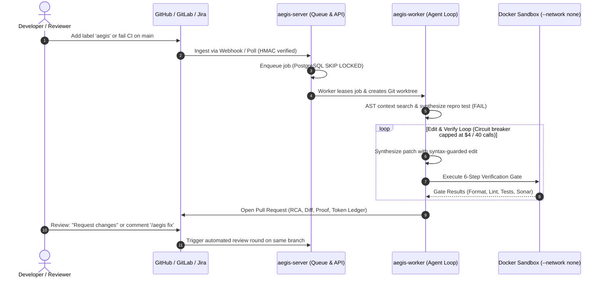
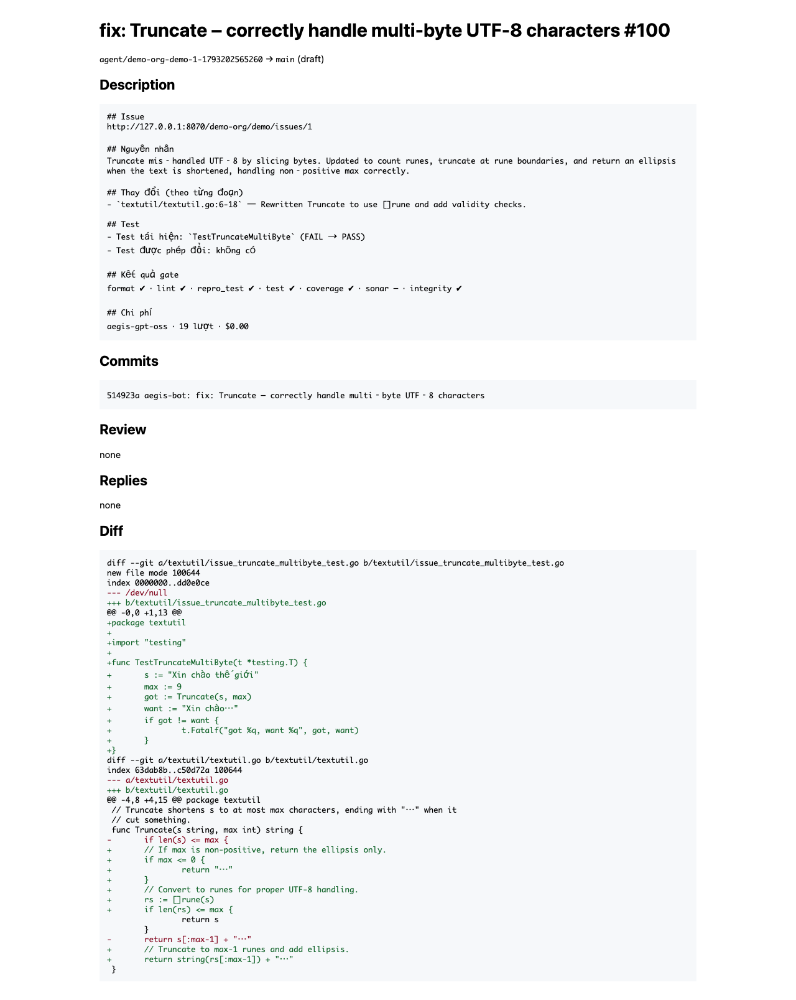
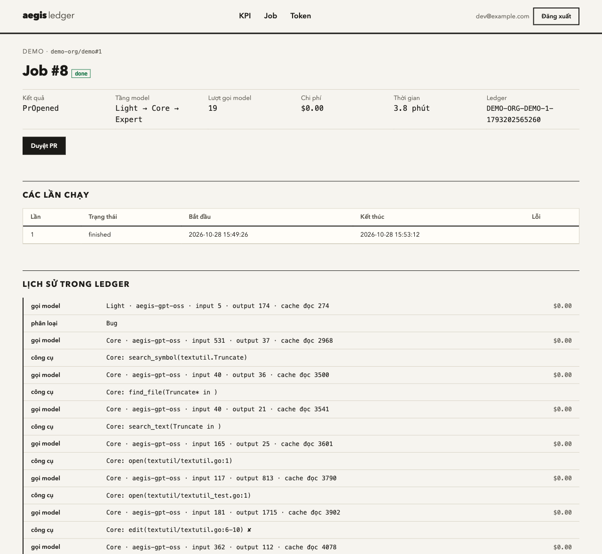
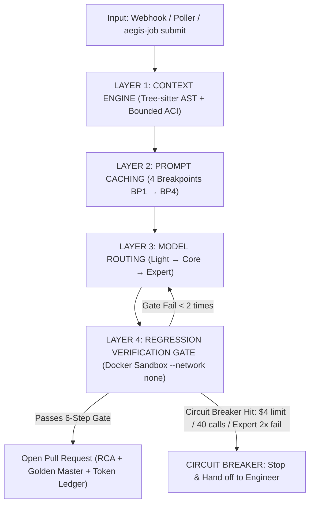

<p align="center">
  
</p>

# Aegis Platform (`aegis-code`)

> **Autonomous Code Maintenance Platform:** Agentic software maintenance powered by AI — ingests issues, localizes root causes via AST graphs, synthesizes verified patches, and opens high-quality Pull Requests for human review.

[](https://www.rust-lang.org)
[](LICENSE)
[]()
[](https://www.npmjs.com/package/@hoanghainh1188/aegis-job)

---

## 🎯 1. Context & Objectives

### The Problem
In enterprise software engineering, code maintenance (resolving production bugs, addressing CI test breakages, remediating SonarQube quality alerts) consumes thousands of engineering hours annually (~2–3 FTEs per organization). This manual, repetitive loop causes context fatigue, introduces unintended regressions, and delays core feature delivery.

### Vision & The Agentic SDLC
Aegis transforms manual maintenance into an **Agentic Software Development Life Cycle (SDLC)**:
* **Automates 80% of Repetitive Tasks:** Ingests tickets $\rightarrow$ locates root causes via AST relational graphs $\rightarrow$ synthesizes failing reproduction test cases $\rightarrow$ implements patches $\rightarrow$ rigorously validates against a 6-step isolated sandbox gate $\rightarrow$ publishes comprehensive Pull Requests.
* **Strict "Human-in-the-Loop" Principle:** Aegis **never merges autonomously**. Final approval and merge decisions always remain with human engineers. Review time drops from **3–5 hours to 5–10 minutes** per issue.

### Core KPIs: Targets and Measured Results
Thresholds are set in [ADR 0005](docs/adr/0005-kpi-thresholds-after-phase-1.md). "Measured" is the Phase 1 evaluation: 32 real, already-fixed issues from two open-source projects, scrapy (Python, 14) and typst (Rust, 18), with hidden tests ([eval/README.md](eval/README.md), [report](docs/measurements/2026-10-24-eval-kpi.md)).

| Metric | Target | Measured (Phase 1) | Description |
| :--- | :---: | :---: | :--- |
| **Acceptance Rate** | $\ge 40\%$ total, $\ge 35\%$ per language | **50%** (Python 64%, Rust 39%) | PRs a reviewer accepts with at most 10 lines edited. |
| **Zero Regression** | 0 | **0** | PRs that break an existing test and still reach a reviewer. |
| **Cost per Issue** | $\le \$4$ average | **$0.55** | Model spend per issue, failed runs included. A job is stopped at $4 or 40 model calls. |
| **Review Time** | $\le 15$ min | **1.8 min** | Human time to judge one PR. |
| **Prompt Cache Reads** | $\ge 70\%$ | **92%** | Share of input tokens served from the prompt cache. |

Caveats: both projects are public, so models may have seen their fixes during training; Phase 1 reviewers could see hidden test results, which shortens review time. Both are re-measured on internal repositories during the pilot (#158). The four Phase 2 profiles (TypeScript, Java, Go, C#) have passed a dry run (19/20 issues, [report](docs/measurements/2026-10-29-new-profiles-dry-run.md)); their KPI run is #259.

---

## 🔄 2. How It Works (End-to-End Workflow)



1. **Ingest:** Triggered automatically via GitHub/GitLab webhook (labels like `aegis`), polled tickets (Jira, Backlog), failed CI runs on `main`, or manually via `aegis-job submit`.
2. **Reproduce & Isolate:** The agent navigates the codebase using bounded AST tools, generates a minimal reproducing test, and confirms that it **FAILS** before making changes.
3. **Patch & Verify:** The agent edits code with syntax-safe linters and executes the 6-step gate inside an isolated Docker sandbox container (`--network none`).
4. **Human Review & Review Rounds:** The agent opens a PR detailing the root cause, verification evidence, and cost breakdown. If a reviewer requests changes or comments `/aegis fix`, the agent triggers a review round on the same branch without force-pushing.

### What You Get

Screenshots from a [local trial](docs/local-trial.md) run with a free local model (Ollama `gpt-oss:20b`), fixing a Go function that cut multi-byte strings in the middle of a character. The PR body and the dashboard are currently written in Vietnamese; the annotations below give the English.

**The pull request** — what a reviewer reads. *Issue*, *Nguyên nhân* (root cause), *Thay đổi* (changes, per hunk), *Test* (the reproducing test, FAIL before the patch and PASS after; *Test được phép đổi*: existing tests the patch was allowed to change, here none), *Kết quả gate* (every gate step), *Chi phí* (model, calls, USD). The diff holds the new test and the fix:

<p align="center"></p>

**The job page** on the dashboard — every model call, tool call, escalation and gate run, with its cost. Here the Core model's edits were rejected by the syntax check twice, so the job moved up to the Expert tier, wrote the reproducing test, fixed the function, and passed the gate in 3.8 minutes:

<p align="center"></p>

The reviewer's side of this, step by step, is in the [Reviewer Guide](docs/reviewing.md).

### Glossary

| Term | Meaning |
| :--- | :--- |
| **Job** | One attempt to resolve one issue (or one CI failure, or one review round). Visible on the dashboard and through `aegis-job`. |
| **Gate** | The verification run in a network-isolated Docker sandbox: format, lint, reproducing test (FAIL → PASS), full test suite, coverage, Sonar, integrity. A PR is opened only when it passes. |
| **Reproducing test** | A test the agent writes that fails on the current code and passes after the fix — the proof that the bug is real and fixed. |
| **Language profile** | Per-language settings: sandbox image, build/test/lint commands, test conventions (`profiles/*.toml`, [ADR 0004](docs/adr/0004-multi-language-profiles.md)). |
| **Mode** | A named server configuration a repo runs under: which models, provider and region (`poc` = Claude API, `customer-jp` = Bedrock in Tokyo, or your own local-model file). |
| **Fork** | The repository the agent pushes `agent/*` branches to and opens PRs in. Either a bot-owned fork of the upstream repo, or the upstream repo itself. |
| **Light / Core / Expert** | The three model tiers: triage, main solving, and escalation for hard cases. |
| **Circuit breaker** | The per-job ceiling ($4 or 40 model calls). The job stops and reports `stopped_budget` / `stopped_steps` instead of opening a PR. |
| **Review round** | A follow-up job on an open PR, started by *Request changes* or a `/aegis fix` comment; it pushes a new commit to the same branch. |
| **Ledger** | The per-job record of every model call, its tokens and its cost. |

---

## 🚀 3. Quick Start & Installation

Choose the path that fits your role.

> [!IMPORTANT]
> **No release has been published yet.** There is no `vX.Y.Z` tag, so the npm package `@hoanghainh1188/aegis-job`, the GHCR images and the offline bundles do not exist yet; they appear with the first release ([docs/release.md](docs/release.md)). Until then:
> * **Developers** install `aegis-job` from source (the `cargo install` line below).
> * **Operators** build the images locally and deploy them with `--offline` ([On-Premise Runbook, "Before the First Release"](docs/runbook/on-premise.md#before-the-first-release-local-images)).
> * The **local trial** and **building from source** work as written.

### 3.1 For Developers (Submit & Follow Jobs)
Interact with an Aegis instance your team already runs, from your terminal, using `aegis-job` ([ADR 0006](docs/adr/0006-developer-client.md), [docs/client.md](docs/client.md)). You need its URL and a role on your repo from its administrator; to try it without one, use the local trial (3.2). Most jobs do not need the CLI at all: adding the `aegis` label to an issue starts one.

```bash
# Install from source via Cargo (until the first release)
cargo install --locked --git https://github.com/hoanghainh1188/aegis-code aegis-client

# After the first release: install via npm (macOS, Linux - prebuilt binaries bundled)
npm install -g @hoanghainh1188/aegis-job

# Log in with your personal token (from https://<aegis-server>/me/tokens)
aegis-job login https://aegis.internal.example.com

# Submit an issue and watch progress live
aegis-job submit my-repo owner/repo#42
aegis-job watch <job-id>
```

### 3.2 For Quick Trial (30-Minute Local Sandbox)
Run the entire platform on a single machine with zero external cloud dependencies ([docs/local-trial.md](docs/local-trial.md)). This spins up PostgreSQL, a mock GitHub service, mock OIDC, and a sample Go repository with a known bug:

```bash
# Clone the repository
git clone https://github.com/hoanghainh1188/aegis-code.git
cd aegis-code

# Start with local Ollama (100% free, requires Ollama running)
./scripts/trial/up.sh ollama

# Or start with Claude API (faster, requires ANTHROPIC_API_KEY)
export ANTHROPIC_API_KEY="sk-ant-..."
./scripts/trial/up.sh claude

# Tear down when finished
./scripts/trial/down.sh
```

### 3.3 For Operators & DevOps (Self-Hosted & Production)
* **On-Premise (Single Linux Host with Docker):** Set up in minutes via Docker Compose or systemd ([docs/runbook/on-premise.md](docs/runbook/on-premise.md), [ADR 0007](docs/adr/0007-on-premise-deployment.md)):
  ```bash
  cd deploy/compose
  sudo ./install.sh                     # Prepares /srv/aegis/.workspace and ./secrets
  # Configure ./server.toml and secrets in ./secrets/
  sudo ./aegis-deploy.sh 0.1.0          # Release version without "v" (images are tagged 0.1.0)
  ```
  Before starting, collect what the [Preparation Checklist](docs/runbook/on-premise.md#preparation-checklist) lists (SSO client, bot account, tokens, domain with TLS, model API key).
* **Cloud Infrastructure (AWS):** Production-grade deployment with OpenTofu (EC2, RDS PostgreSQL, Secrets Manager, ALB with TLS, CloudWatch) in [deploy/tofu/](deploy/tofu/) and [docs/runbook/README.md](docs/runbook/README.md).
* **Kubernetes:** Run worker pods with Docker-in-Docker sidecars for safe sandbox isolation ([ADR 0008](docs/adr/0008-gate-sandbox-on-kubernetes.md)).

### 3.4 For Contributors (Build & Test from Source)
* **Prerequisites:** Rust stable (edition 2024, 1.85+) and Docker.
```bash
# Build core CLI and tool daemon
cargo build --release -p aegis-cli -p aegis-aci

# Run formatting and clippy linter checks
cargo fmt --check
cargo clippy --workspace --all-targets -- -D warnings
cargo clippy -p aegis-provider --all-targets --features bedrock -- -D warnings

# Execute test suite
cargo test --workspace
cargo test -p aegis-provider --features bedrock
```

---

## 🏛️ 4. System Architecture

The platform is engineered 100% in **Rust** as a Cargo Workspace ([ADR 0001](docs/adr/0001-platform-in-rust.md)), ensuring native speed, minimal memory overhead, and strong concurrency safety.

### 4-Layer Control Architecture



1. **Layer 1 – Context Engine:**
   * Tree-sitter AST queries per language profile. Builds in-memory module maps and call graphs (`CALLS`, `IMPORTS`, `TESTS`) via Codebase-Memory MCP and language servers.
   * **Bounded ACI Tools:** Reads code in capped windows (100 lines at a time, SWE-agent standard) and bounds search output to 50 results. The `edit` tool validates syntax via linters prior to persisting changes.
   * **Batch History Collapse:** Once context usage reaches $60\%$ of the model window, older tool observations collapse into `[Observation collapsed]` tokens, preserving reasoning while retaining cache efficiency.
2. **Layer 2 – Deterministic Prompt Caching:**
   * Strict 4-breakpoint hierarchy: `BP1` (Tool schemas) $\rightarrow$ `BP2` (System prompt, conventions) $\rightarrow$ `BP3` (Issue context, repo metadata, repro test) $\rightarrow$ `BP4` (Dynamic message history).
   * Byte-stable serialization (sorted keys, omitted dynamic timestamps) achieves **$\ge 70\%$ cache hit rates**, cutting input token costs by up to 90–95%.
3. **Layer 3 – Model Hierarchy & Circuit Breakers:**
   * **Light (`Haiku 5.5`):** Issue classification, stack trace pruning, and log summarization.
   * **Core (`Sonnet 5.5`):** Root-cause localization, reproducing test creation, patch synthesis.
   * **Expert (`Opus 5.5`):** Complex architecture refactoring spanning $\ge 3$ files.
   * **Economic Circuit Breaker:** Stops execution immediately if cost exceeds $\$4$ or reaches 40 model calls (excluding Light preprocessing).
4. **Layer 4 – 6-Step Verification Gate in Docker:**
   * Format $\rightarrow$ Lint $\rightarrow$ Repro Test (proves FAIL $\rightarrow$ PASS) $\rightarrow$ Full Test Suite $\rightarrow$ Coverage $\rightarrow$ Sonar Quality Gate.
   * Runs in network-isolated containers (`--network none`, `--cap-drop ALL`, non-root user).
   * **Golden Master Technique:** For legacy code without test coverage, the agent writes characterization tests capturing existing behavior prior to patching; any modified output must be declared under *"Permitted Behavior Changes"* in the PR description.

### Enterprise Service Architecture
* **Unified Binary (`aegis-server`):** Written with Axum, runnable via `--role api|worker|all` ([ADR 0003](docs/adr/0003-platform-service-architecture.md)).
* **PostgreSQL Queue:** ACID-compliant job scheduling using `SELECT ... FOR UPDATE SKIP LOCKED` (no Redis/SQS overhead, zero duplicate dispatch).
* **Minimalist Dashboard:** Server-rendered with **Askama + htmx**, secured with OIDC SSO and role-based personal access tokens.
* **Security & Data Residency:**
  * **Japan Data Residency (`customer-jp.toml`):** Enforces routing exclusively via AWS Bedrock in `ap-northeast-1` (Tokyo). The `aegis-provider` crate enforces `ModelPolicy::JapanOnly`.
  * **Indirect Prompt Injection Defense:** All comments, README files, and issue bodies are sanitized and handled as untrusted external input.

---

## 🛠️ 5. Deployment & Operations

### Deployment Flavors
| Deployment Target | Orchestration | State Store | Secrets Source | Best For | Runbook |
| :--- | :--- | :--- | :--- | :--- | :--- |
| **AWS (Production)** | EC2 + systemd | RDS PostgreSQL | AWS Secrets Manager | Cloud enterprise, High availability | [AWS Runbook](docs/runbook/README.md) |
| **On-Premise Compose** | Docker Compose | Local PostgreSQL | File-based (`./secrets/`) | Internal data centers, Private clouds | [On-Premise Runbook](docs/runbook/on-premise.md) |
| **On-Premise systemd** | Host systemd | Dedicated Postgres | File-based (`/etc/aegis/secrets/`) | Bare-metal Linux servers | [ADR 0007](docs/adr/0007-on-premise-deployment.md) |
| **Kubernetes** | Worker Pods | External Postgres | K8s Secrets / CSI | Cloud-native multi-tenant clusters | [ADR 0008](docs/adr/0008-gate-sandbox-on-kubernetes.md) |

### Monitoring & Observability
* **Prometheus Metrics:** Exported at `:9464/metrics` (or `:8080/metrics`). Tracks job durations, gate pass rates, token consumption, and model spending.
* **Alerting:** Pre-configured Alertmanager rules for job queue stalling, consecutive gate failures, and budget threshold breaches (`deploy/alerts/`).
* **Grafana Dashboards:** Ready-to-import dashboards for operational performance and financial accounting (`deploy/grafana/`).

### Backups & Rollbacks
* **Database Backup:** Run `sudo ./deploy/compose/backup.sh` for atomic `pg_dump` snapshots.
* **Instant Rollbacks:** Re-run `./aegis-deploy.sh <previous-version>` (e.g. `0.1.0`, no `v`). Aegis utilizes expand/contract database migrations ensuring backwards compatibility across releases.

---

## ⚡ 6. Core Capabilities

* 📥 **Multi-Channel Ingestion:** Webhooks for GitHub/GitLab (e.g. `aegis` label), polling for Jira/Backlog, automatic detection of broken CI runs on `main`, and SonarQube alerts.
* 🔁 **Review Rounds:** When an engineer clicks *"Request changes"* or comments `/aegis fix`, Aegis returns to the same branch, runs the gate, pushes an additional commit without force-pushing, and replies to review comments.
* 🔍 **Automated Triage:** Light models prune stack traces and pinpoint likely candidate crates/modules before heavy synthesis begins.
* 🧪 **Isolated Reproducing Tests:** Synthesizes dedicated test cases to verify the bug condition before proposing code changes.
* 🛠️ **Syntax-Guarded Patching:** Rejects AST-invalid code edits immediately without wasting full sandbox test cycles.
* 📦 **Sonar Batching:** Clusters related static analysis warnings by AST node or tainted dataflow, resolving them concurrently.
* 🛡️ **Zero Regression Enforcement:** Guarantees 100% test suite passage and enforces coverage thresholds ($\ge 80\%$) prior to submission.
* 💰 **Auditable Cost Ledger:** `aegis-ledger` tracks token expenditures per call and terminates tasks before budgets are exceeded.

---

## 📂 7. Repository Structure

```
aegis-code/
├── crates/
│   ├── aegis-provider/       # LLM provider clients (Anthropic Claude API & AWS Bedrock jp)
│   ├── aegis-orchestrator/   # Core agent loop, session state, observation collapsing
│   ├── aegis-router/         # Light / Core / Expert hierarchy & economic circuit breakers
│   ├── aegis-aci/            # MCP code tools: search, bounded open, syntax-guarded edit
│   ├── aegis-lang/           # Multi-language profiles: Rust, Python, TS/JS, Java, Go, C# (ADR 0004)
│   ├── aegis-gate/           # 6-step Docker verification sandbox runner
│   ├── aegis-lifecycle/      # End-to-end issue workflow (triage, solve, verify, open PR)
│   ├── aegis-ledger/         # Financial accounting: per-call token ledger and USD pricing
│   ├── aegis-pr/             # Git branch management and structured PR description synthesis
│   ├── aegis-sonar-batch/    # Static analysis clustering & integration branch merging
│   ├── aegis-tracker/        # Issue trackers: Jira and Backlog integration
│   ├── aegis-secrets/        # Secret management (AWS Secrets Manager & file-based secrets)
│   ├── aegis-store/          # PostgreSQL data access: jobs, repos, leases, tokens, audit logs
│   ├── aegis-server/         # Platform HTTP API, scheduler, webhook receiver, htmx dashboard (ADR 0003)
│   ├── aegis-client/         # Developer CLI binary: aegis-job (ADR 0006)
│   └── aegis-cli/            # Local developer CLI for evaluation benchmarks and single issues
├── deploy/                   # Deployment scripts (compose, systemd, tofu, grafana, alerts)
├── docker/                   # Dockerfiles for aegis-server and language sandboxes
├── docs/                     # Architectural decision records (ADRs), runbooks, and design specs
├── eval/                     # Empirical benchmark datasets (Rust, Python, TS, Java, Go, C#)
├── npm/                      # Pre-bundled npm package wrapper for @hoanghainh1188/aegis-job
└── scripts/                  # Operational scripts (local trial, releases, benchmarks)
```

---

## 🗺️ 8. Roadmap & Project Status

Progress is tracked via [GitHub Milestones](https://github.com/hoanghainh1188/aegis-code/milestones). Status as of October 2026:

* ✅ **Phase 0 – Setup** (Completed): CI/CD pipelines, Docker sandbox hardening, build time benchmarking, 30–50 issue evaluation set ([Proposal §9](docs/design/00-proposal.md)).
* ✅ **Phase 1 – MVP / PoC** (Completed): Core agent loop, Rust and Python language profiles, empirical validation against 3 Core KPIs ([ADR 0002](docs/adr/0002-full-platform-mvp-as-checkpoint.md), [ADR 0005](docs/adr/0005-kpi-thresholds-after-phase-1.md)).
* 🚧 **Phase 2 – Platform Service** (~90% Completed – Final Stage):
  - **Completed:** TypeScript/JavaScript, Java, Go, C#/.NET profiles; unified `aegis-server` service; PostgreSQL transactional queue (`SKIP LOCKED`); GitHub/GitLab webhooks; Jira/Backlog polling; Askama + htmx dashboard with OIDC; Prometheus/Grafana monitoring; automated review rounds; developer CLI `aegis-job` on npm; on-premise Docker Compose and systemd bundles; Kubernetes dind documentation ([ADR 0008](docs/adr/0008-gate-sandbox-on-kubernetes.md)).
  - **In Progress / Remaining:** Staging cloud deployment via OpenTofu (#33), KPI evaluations on the 4 new language profiles (52 issues, [eval/README.md](eval/README.md), #259), and real-world team pilot (#158).
* ⏳ **Phase 3 – Advanced Scaling** (Planned): Spectrum-Based Fault Localization (SBFL), deep context compression (SWEzze/SaraCoder), and expansion to additional language ecosystems.

---

## 📖 9. References & Documentation

### Architectural Decision Records (ADRs)
* [ADR 0001: Platform Written in Rust](docs/adr/0001-platform-in-rust.md)
* [ADR 0002: Full Platform MVP as Checkpoint](docs/adr/0002-full-platform-mvp-as-checkpoint.md)
* [ADR 0003: Platform Service Architecture](docs/adr/0003-platform-service-architecture.md)
* [ADR 0004: Multi-Language Profiles](docs/adr/0004-multi-language-profiles.md)
* [ADR 0005: KPI Thresholds After Phase 1](docs/adr/0005-kpi-thresholds-after-phase-1.md)
* [ADR 0006: Developer Client (`aegis-job`)](docs/adr/0006-developer-client.md)
* [ADR 0007: On-Premise Deployment](docs/adr/0007-on-premise-deployment.md)
* [ADR 0008: Gate Sandbox on Kubernetes](docs/adr/0008-gate-sandbox-on-kubernetes.md)

### Detailed Guides & Runbooks
* [Reviewer Guide](docs/reviewing.md) – Reading an Aegis PR, asking for review rounds, recording the verdict
* [Developer Client Guide (`aegis-job`)](docs/client.md) – Submitting and monitoring jobs from terminal
* [Local End-to-End Trial Guide](docs/local-trial.md) – Step-by-step local platform walkthrough
* [Production AWS Runbook](docs/runbook/README.md) – Deployment, secret rotation, and incident triage
* [On-Premise Operations Runbook](docs/runbook/on-premise.md) – Single-machine Docker Compose and systemd management
* [Release Operations](docs/release.md) – Release-please, GHCR container images, and offline packages
* [Contributing & Development Conventions](CLAUDE.md) – Commit formats, branching, and pre-PR verification

> *Note: All architectural specifications (ADRs), operations runbooks, and developer procedural guides across `docs/` are fully maintained in English.*

---

## License

Licensed under the Apache License, Version 2.0: [LICENSE](LICENSE).
