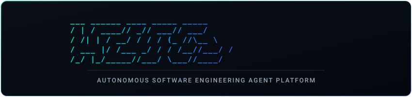
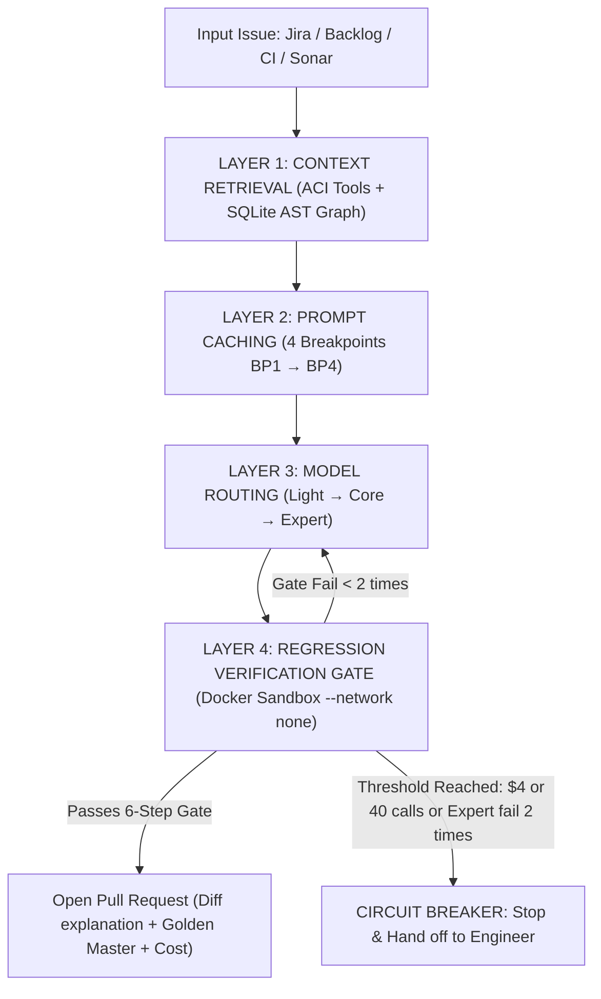

<p align="center">
  
</p>

# Aegis Platform (`aegis-code`)

> **Agentic Code Maintenance Platform:** Autonomous software maintenance powered by AI agents — ingest issues, analyze context, generate safe patches, and open verified Pull Requests for human review.

[](https://www.rust-lang.org)
[]()
[]()

---

## 🎯 1. Context & Objectives

### The Problem
In large-scale software engineering projects, code maintenance (fixing production bugs, addressing CI failures, resolving SonarQube alerts) consumes thousands of engineering hours annually (~2–3 FTEs). This manual loop causes context fatigue, introduces regressions, and slows down feature delivery.

### Vision & Solution
Aegis transitions manual maintenance into an **Agentic SDLC**:
* The AI Agent handles **80% of repetitive tasks**: understand tickets $\rightarrow$ locate root causes via AST graph $\rightarrow$ write reproducing tests $\rightarrow$ generate patches $\rightarrow$ verify via sandbox test suites and Sonar $\rightarrow$ open comprehensive Pull Requests.
* **Strict "Human-in-the-loop" Principle:** The agent **never merges autonomously**. Final approval always rests with human engineers. Review time drops from 3–5 hours to 5–10 minutes per issue.

### 3 Core KPIs
| Metric | Target Threshold | Description |
| :--- | :---: | :--- |
| **Acceptance Rate** | $\ge 40\%$ | Ratio of PRs accepted and merged by engineers with minor edits ($\le 10$ lines). |
| **Cost Efficiency** | $\le \$4 - \$8$ / issue | Average model API cost per issue (including failed attempts and regional markups). |
| **Zero Regression** | $0\%$ regressions | No PR that breaks existing tests is ever submitted to human reviewers. |

---

## 🏛️ 2. System Architecture

The platform is written 100% in **Rust** as a Cargo Workspace ([ADR 0001](docs/adr/0001-platform-in-rust.md)), providing high performance, memory safety, and cross-language consistency.

### Issue Lifecycle Flow (4 Control Layers)



### Core Architecture Layers
1. **Layer 1 – Context Engine:**
   * Tree-sitter AST queries per language profile. The prompt includes a module map generated from source code. Relational graph queries (`CALLS`, `IMPORTS`, `TESTS`) via Codebase-Memory MCP and language servers (`rust-analyzer`, `basedpyright`, etc.) are designed in [Design §3.2](docs/design/01-architecture-detail.md).
   * Bounded ACI toolset: opens exactly 100 lines at a time (SWE-agent standard) and caps search results at 50 entries. The `edit` tool verifies syntax with a linter before persisting changes to disk.
   * **Batch History Collapse:** When context reaches $60\%$ of the window, older observation outputs collapse into `[Observation collapsed]` to protect cache efficiency while preserving the model's reasoning chain.
2. **Layer 2 – Deterministic Prompt Caching:**
   * Fixed 4-breakpoint hierarchy: `BP1` (Tools) $\rightarrow$ `BP2` (System prompt, conventions) $\rightarrow$ `BP3` (Issue context, repro test) $\rightarrow$ `BP4` (Dynamic conversation history).
   * Byte-stable structure (sorted JSON keys, no dynamic timestamps/session IDs in BP1–BP2) achieving **$\ge 70\%$ cache hit rates** (saving 90–95% on input token costs).
3. **Layer 3 – Model Hierarchy & Circuit Breaker:**
   * **Light (`Haiku 5.5`):** Issue classification, build/test log summarization, stack trace pruning.
   * **Core (`Sonnet 5.5`):** Root-cause localization, reproducing test creation, patch synthesis.
   * **Expert (`Opus 5.5`):** Architecture refactoring, complex bugs across $\ge 3$ files.
   * **Economic Circuit Breaker:** Halts execution immediately if cost exceeds $\$4$ or reaches 40 model calls (Light calls not counted; raised from 20 after the first eval run, see [design §5.3](docs/design/01-architecture-detail.md)).
4. **Layer 4 – 6-Step Verification Gate in Docker:**
   * Format $\rightarrow$ Lint $\rightarrow$ Repro Test (proves FAIL $\rightarrow$ PASS) $\rightarrow$ Full Test Suite $\rightarrow$ Coverage $\rightarrow$ Sonar Quality Gate (when `[sonar]` is configured, #91). Commands are loaded from the target repository's language profile (e.g. Rust: `cargo fmt`, `cargo clippy`, `cargo llvm-cov`) — see [ADR 0004](docs/adr/0004-multi-language-profiles.md).
   * **Golden Master Technique:** For legacy code without test coverage, the agent writes characterization tests capturing existing behavior prior to patching; any modified output must be declared under *"Permitted Behavior Changes"* in the PR description.

### Enterprise Service Architecture (Phase 2 Platform Service)
As specified in [ADR 0003](docs/adr/0003-platform-service-architecture.md):
* Single binary `aegis-server` (Axum) configurable via `--role api|worker|all`.
* Transactional job queue on **PostgreSQL** using `SELECT ... FOR UPDATE SKIP LOCKED` (ACID-compliant, atomic budget deduplication, zero external Redis/SQS overhead).
* Minimalist server-rendered dashboard (**Askama + htmx**) secured with OIDC and AWS Secrets Manager.

### Security & Data Governance
* **Japan Data Residency:** Customer profiles (`customer-jp.toml`) route through AWS Bedrock in `ap-northeast-1` (Tokyo/Osaka). The `aegis-provider` crate enforces `ModelPolicy::JapanOnly`, rejecting any non-`jp.` endpoint.
* **Network-Isolated Sandbox:** Containers execute with `--network none`, without mounting credentials, tokens, or `.env` files.
* **Indirect Prompt Injection Defense:** All source code comments, README files, and issue descriptions are treated as untrusted user inputs.

---

## ⚡ 3. Core Capabilities

* 📥 **Multi-Channel Ingestion:** Ingest issues from Jira, Backlog, CI failure webhooks (GitHub Actions, GitLab CI), and SonarQube static analysis alerts.
* 🔍 **Automated Triage & Summarization:** Light model analyzes stack traces, identifies suspected modules/crates, and produces structured metadata (`has_repro_info`, `suspected_crates`).
* 🧪 **Isolated Reproducing Tests:** Automatically synthesizes test cases and verifies their initial **FAIL** status before code changes begin.
* 🛠️ **Syntax-Guarded Patching:** The `edit` tool runs linters and syntax checkers, rejecting edits that cause compilation failures.
* 📦 **Sonar Batching & Integration:** Clusters related warnings by AST node or tainted dataflow, resolves them across parallel branches, and merges sequentially into `agent/integration-<batch-id>`.
* 🛡️ **Regression Prevention:** Ensures 100% of existing tests pass and new code adheres to quality standards (coverage $\ge 80\%$, duplication $\le 3\%$).
* 📝 **Structured Pull Requests:** Automatically composes PR descriptions with root cause analysis, change details, repro test evidence, verification gate results, Golden Master disclosures, and token cost breakdown.
* 💰 **Cost Accounting & Budget Monitoring:** `aegis-ledger` logs per-call token counts and USD costs to JSON ledgers and database records, terminating runs before exceeding budget thresholds.

---

## 📂 4. Repository Structure

```
crates/
├── aegis-provider/       # ModelProvider: Claude API & Bedrock jp.
├── aegis-orchestrator/   # Agent loop, session state, batch collapse
├── aegis-router/         # Light/Core/Expert hierarchy, escalation & stopping rules
├── aegis-aci/            # MCP code manipulation tools: search, open, edit, call graph
├── aegis-lang/           # Language profiles: detection, grammar, gate steps, dependencies (ADR 0004)
├── aegis-gate/           # 6-step Docker verification gate runner
├── aegis-lifecycle/      # One issue end to end: classify, agent loop, gate, escalate, PR or stop
├── aegis-ledger/         # Cost calculation trait and per-issue ledger
├── aegis-pr/             # Branch management and PR description generator
├── aegis-sonar-batch/    # Sonar alert clustering and integration branch merge
├── aegis-tracker/        # Jira and Backlog: tickets by JQL/filter, job result written back
├── aegis-secrets/        # Secrets from AWS Secrets Manager (env for dev and tests)
├── aegis-store/          # PostgreSQL state: repos, jobs, queue, ledger, users, audit
├── aegis-server/         # The service: HTTP API, webhooks, scheduler, workers, dashboard (ADR 0003)
└── aegis-cli/            # CLI entrypoint to run single issues, batches and evals
```

---

## 🚀 5. Getting Started

### Prerequisites
* Rust toolchain (1.80+)
* Docker (for isolated sandbox verification)

### Build
`aegis` starts `aegis-aci` from its own directory, so build both:
```bash
cargo build --release -p aegis-cli -p aegis-aci
```
Elsewhere, point `run.aci_bin` in the config at it.

### Testing & Verification
```bash
# Check code formatting
cargo fmt --check

# Run linter checks (workspace and Bedrock backend)
cargo clippy --workspace --all-targets -- -D warnings
cargo clippy -p aegis-provider --all-targets --features bedrock -- -D warnings

# Execute test suite
cargo test --workspace
cargo test -p aegis-provider --features bedrock
```

---

## 🗺️ 6. Roadmap

Progress is tracked on the [GitHub milestones](https://github.com/hoanghainh1188/aegis-code/milestones); status as of 2026-10-25:

* ✅ **Phase 0 – Setup** (closed 2026-10-24): CI pipelines, Docker sandbox hardening, build time benchmarking, 30–50 issue evaluation set ([Proposal §9](docs/design/00-proposal.md)).
* ✅ **Phase 1 – MVP / PoC** (closed 2026-10-24): Core crates, Rust and Python profiles; empirical 3-KPI evaluation on target repositories ([ADR 0002](docs/adr/0002-full-platform-mvp-as-checkpoint.md), thresholds in [ADR 0005](docs/adr/0005-kpi-thresholds-after-phase-1.md)).
* 🚧 **Phase 2 – Platform Service** (in progress): TypeScript/JavaScript, Java, Go, C#/.NET profiles and per-directory profiles for monorepos; single binary `aegis-server` (Axum), PostgreSQL job queue, GitHub/GitLab webhooks, Jira/Backlog and scheduled Sonar polling, Askama+htmx dashboard, OIDC and audit, Prometheus/Grafana monitoring, OpenTofu deployment ([ADR 0003](docs/adr/0003-platform-service-architecture.md)). Remaining: `tofu apply` to staging (#33), eval sets for the four new profiles, KPI re-runs, and a pilot with a real team.
* ⏳ **Phase 3 – Advanced Scaling** (not started): SBFL fault localization, deep context compression (SWEzze/SaraCoder), language support beyond the initial 6 profiles.

---

## 📖 7. References & Conventions

* [Project Proposal](docs/design/00-proposal.md) (Foundational vision and requirements)
* [Technical Architecture Specification](docs/design/01-architecture-detail.md) (Phase 1 core specification; the service layer is in [ADR 0003](docs/adr/0003-platform-service-architecture.md))
* [Operations Runbook](docs/runbook/README.md) (Deploy, rollback, secret rotation, incidents, monitoring)
* [Developer Client `aegis-job`](docs/client.md) (Submit and follow jobs from your terminal with a personal token, [ADR 0006](docs/adr/0006-developer-client.md))
* [Local End-to-End Trial](docs/local-trial.md) (The whole flow on one machine: `scripts/trial/up.sh`, a fake GitHub, Ollama or the Claude API)
* [Measurements](docs/measurements/) (Eval runs and KPI reports)
* [Architectural Decision Records (ADRs)](docs/adr/)
* [Development Conventions & Workflow](CLAUDE.md) (Branching, commit conventions, and pre-PR checks)
