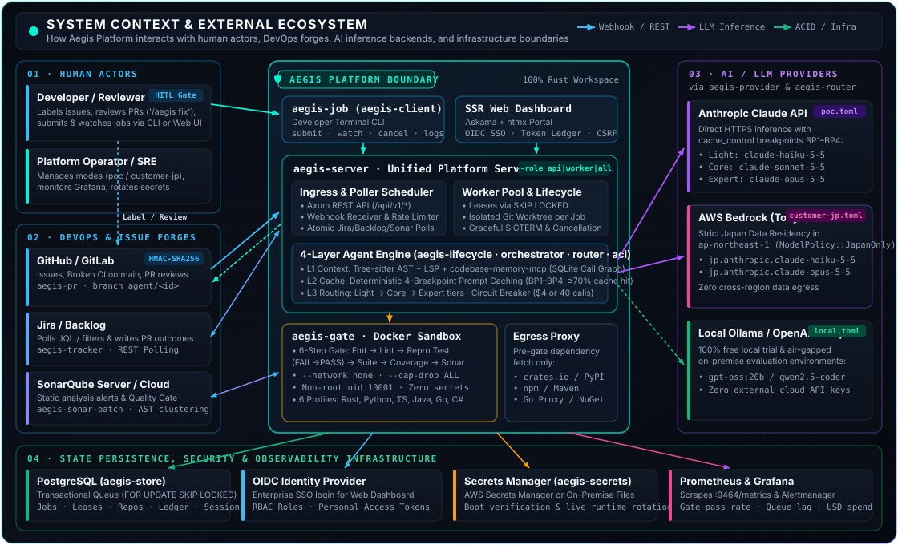
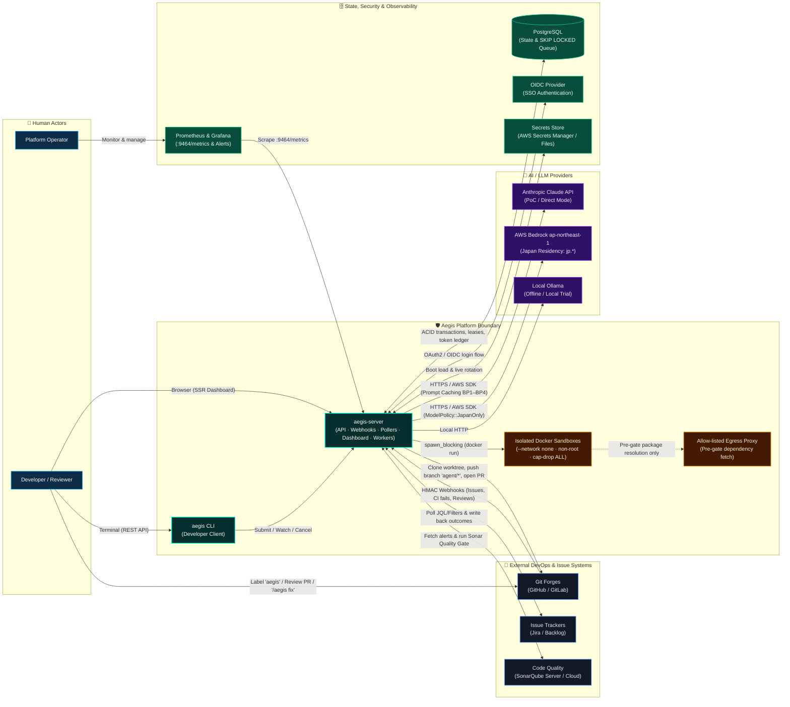
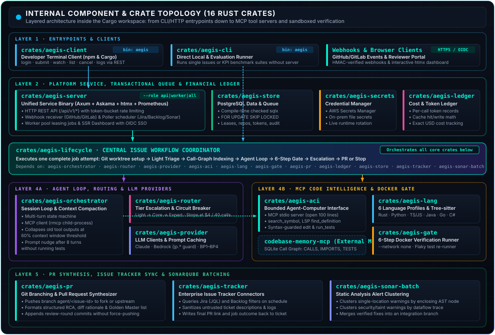
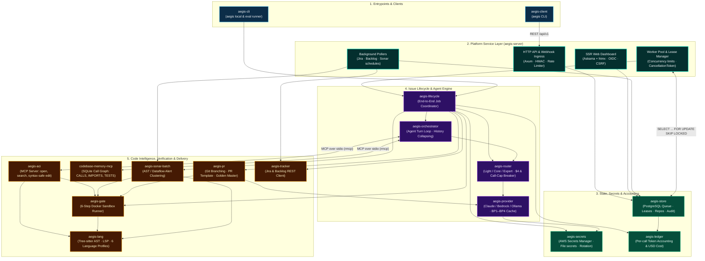

# Platform Topology: System Context and Crates

How Aegis sits among the systems around it, and how its 16 crates are wired together. The scope and the four control layers are in the [Proposal](00-proposal.md); the core engine, layer by layer, is in the [Architecture Specification](01-architecture-detail.md). The service architecture decisions are in [ADR 0003](../adr/0003-platform-service-architecture.md).

## 1. System Context & External Integrations

Aegis sits between your engineering workflow tools (Git forges, issue trackers, static analyzers) and LLM providers, operating within a strictly controlled host boundary:

  

<b>🔍 View Interactive Mermaid Diagram (System Context)</b>

| External System | Direction | Protocol / Mechanism | Purpose & Security Boundary | Handled By |
| :--- | :---: | :--- | :--- | :--- |
| **Developers & Reviewers** | $\leftrightarrow$ | HTTPS (Browser / `htmx`), REST API (`/api/v1/*`) | View job ledgers on the dashboard, submit/watch jobs via `aegis`, or review PRs on GitHub/GitLab. | `aegis-server`, `aegis-client` |
| **GitHub / GitLab** | $\leftrightarrow$ | Webhooks (`X-Hub-Signature-256` / `X-Gitlab-Token`), Git / HTTPS API | Ingests labeled issues, `main` CI breakages, and PR review comments; pushes `agent/<id>` branches and opens structured PRs. | `aegis-server`, `aegis-pr` |
| **Jira / Backlog** | $\leftrightarrow$ | REST API Polling (atomic `polls` schedule) | Polls issues matching configured JQL/filters and writes resolution status/PR links back to the ticket. | `aegis-tracker`, `aegis-server` |
| **SonarQube** | $\leftrightarrow$ | Web API + `sonar-scanner` CLI | Ingests static analysis warnings (clustered by AST/dataflow) and verifies patches against the Sonar Quality Gate. | `aegis-sonar-batch`, `aegis-gate` |
| **Claude / Bedrock / Ollama** | $\rightarrow$ | HTTPS / AWS SDK (`aws-sdk-bedrockruntime`) | Executes model inference across Light/Core/Expert tiers. Enforces `jp.` inference profiles in `ap-northeast-1` for `customer-jp`. | `aegis-provider`, `aegis-router` |
| **PostgreSQL** | $\leftrightarrow$ | TCP / TLS (`sqlx` compile-time checked) | Stores repositories, transactional job queue (`FOR UPDATE SKIP LOCKED`), worker leases, user sessions, and token cost ledgers. | `aegis-store`, `aegis-ledger` |
| **Docker Daemon & Host** | $\rightarrow$ | Host CLI (`docker run` / `docker rm`) | Runs per-job Git worktrees on host and spawns air-gapped verification containers (`--network none`, `--cap-drop ALL`, uid 10001, bounded memory/CPU/processes, read-only image). | `aegis-gate`, `aegis-lifecycle` |
| **OIDC / Secrets / Metrics** | $\leftrightarrow$ | OIDC, AWS Secrets Manager API, Prometheus | Authenticates dashboard users via SSO, rotates credentials without restart, and exports operational/financial metrics on `:9464/metrics`. | `aegis-server`, `aegis-secrets` |

---

## 2. Internal Architecture & Component Topology

Internally, Aegis is structured into **five modular subsystems** across 16 Rust crates. The unified binary `aegis-server` can run all subsystems in a single process (`--role all`) or split horizontally into stateless API nodes (`--role api`) and compute workers (`--role worker`):

  

<b>🔍 View Interactive Mermaid Diagram (Internal Crate Topology)</b>

### How Internal Components Work Together
1. **Service & Scheduling (`aegis-server`, `aegis-store`, `aegis-secrets`):**
   * **Ingress & UI:** `aegis-server` exposes the REST API, HMAC-verified webhook endpoints, and an **Askama + htmx** server-rendered dashboard secured by OIDC SSO and in-memory token-bucket rate limiting.
   * **Transactional PostgreSQL Queue:** Instead of external brokers (Redis/SQS), `aegis-store` manages the job queue directly in PostgreSQL using `SELECT ... FOR UPDATE SKIP LOCKED` with distributed worker leases (`locked_until`), per-repo concurrency caps, and graceful `SIGTERM` draining.
2. **Lifecycle Coordination (`aegis-lifecycle`):**
   * Serves as the central facade invoked by both `aegis-server` workers (in production) and `aegis-cli` (for local single-issue runs and evaluation benchmarks).
   * Prepares an isolated Git worktree per job, builds the `codebase-memory-mcp` SQLite call graph index, and orchestrates the transition from triage $\rightarrow$ agent loop $\rightarrow$ verification gate $\rightarrow$ PR creation.
3. **Agent Execution Loop (`aegis-orchestrator`, `aegis-router`, `aegis-provider`, `aegis-ledger`):**
   * `aegis-orchestrator` manages multi-turn agent sessions, dispatches tool calls over MCP (`rmcp` child processes), and compacts older tool observations once context usage exceeds $60\%$.
   * `aegis-router` selects the active tier (`Light` $\rightarrow$ `Core` $\rightarrow$ `Expert`) based on failure signals and enforces the economic circuit breaker ($\$4$ or the call cap) backed by real-time accounting in `aegis-ledger`.
   * `aegis-provider` serializes requests with deterministic 4-breakpoint prompt caching (`BP1`–`BP4`) and enforces regional routing policies (`ModelPolicy::JapanOnly` for `customer-jp.toml`).
4. **Code Intelligence & Sandboxed Verification (`aegis-aci`, `aegis-lang`, `aegis-gate`):**
   * `aegis-aci` runs as an MCP tool server providing bounded code windows (`open`, `search_symbol`, `find_definition` via LSP) and syntax-guarded edits (`edit`).
   * `aegis-lang` supplies ecosystem-specific rules (`profiles/*.toml`), Tree-sitter AST grammars, lockfile parsers, and test runners for **Rust, Python, TypeScript/JavaScript, Java, Go, and C#**.
   * `aegis-gate` executes the 6-step verification suite inside a network-isolated Docker container (`--network none`), including automatic re-runs to filter out flaky tests.
5. **External Delivery & Clustering (`aegis-pr`, `aegis-tracker`, `aegis-sonar-batch`):**
   * `aegis-pr` pushes `agent/<issue-id>` branches, formats the bilingual/structured PR description (RCA, diff rationale, gate proof, Golden Master declarations, token ledger), and handles follow-up review rounds on the same branch.
   * `aegis-sonar-batch` groups related SonarQube warnings by enclosing AST node or tainted dataflow trace and merges verified fixes into an integration branch.
   * `aegis-tracker` synchronizes ticket context and final PR status with Jira and Backlog.
