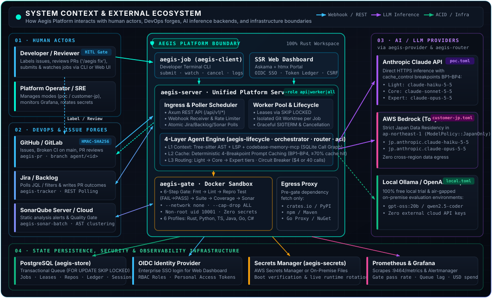
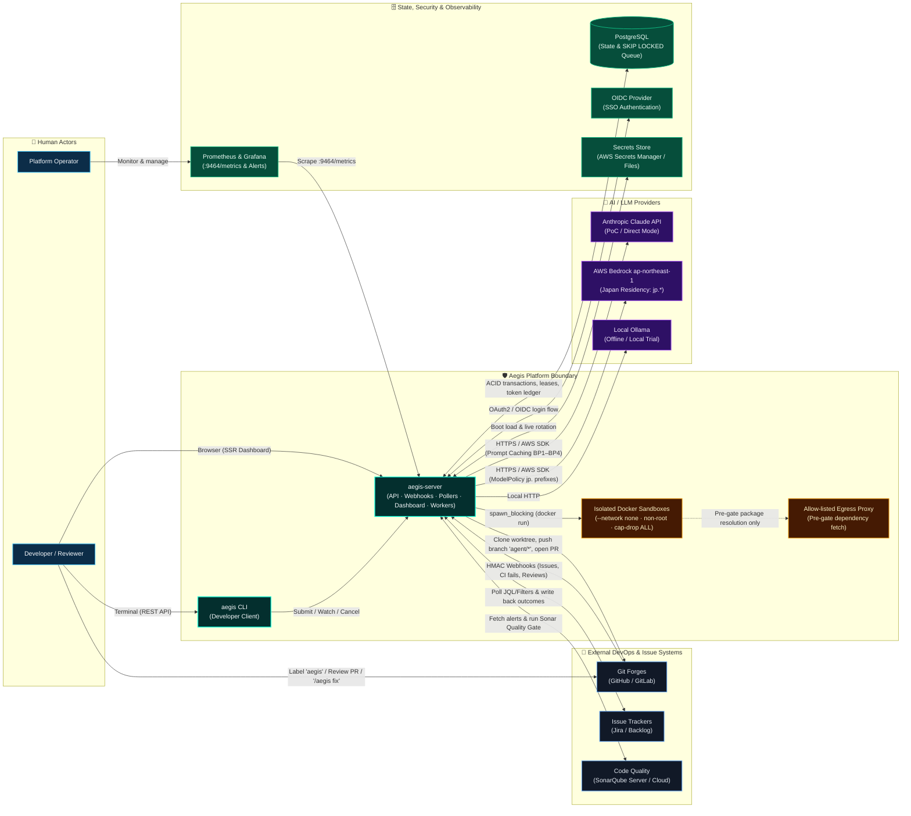
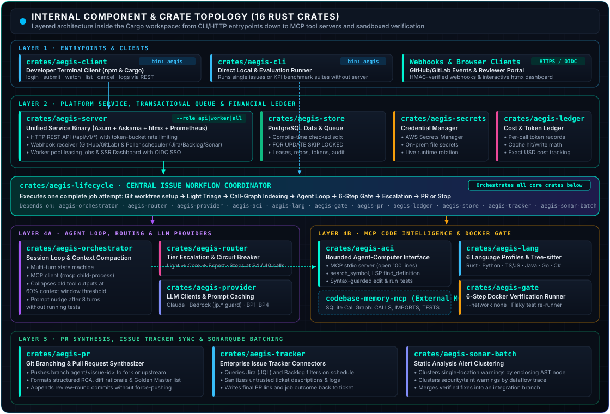
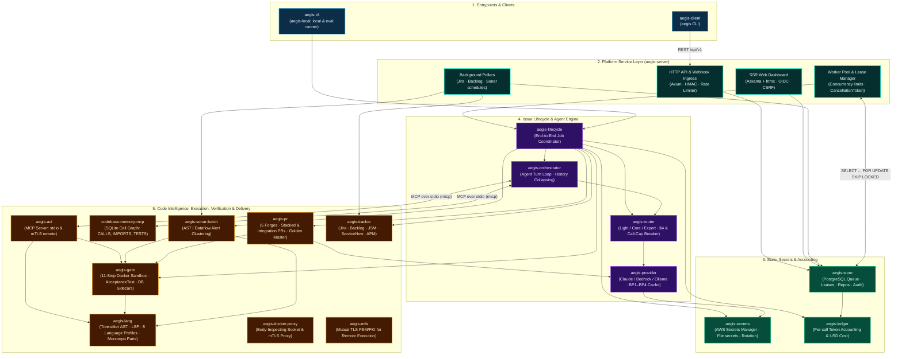

# Platform Topology: System Context and Crates

How Aegis sits among the systems around it, and how its 18 crates are wired together. The scope and the four control layers are in the [Proposal](00-proposal.md); the core engine, layer by layer, is in the [Architecture Specification](01-architecture-detail.md). The service architecture decisions are in [ADR 0003](../adr/0003-platform-service-architecture.md).

## 1. System Context & External Integrations

Aegis sits between your engineering workflow tools (Git forges, issue trackers, static analyzers) and LLM providers, operating within a strictly controlled host boundary:

  

<b>🔍 View Interactive Mermaid Diagram (System Context)</b>

| External System | Direction | Protocol / Mechanism | Purpose & Security Boundary | Handled By |
| :--- | :---: | :--- | :--- | :--- |
| **Developers & Reviewers** | $\leftrightarrow$ | HTTPS (Browser / `htmx`), REST API (`/api/v1/*`) | View job ledgers, pre-flight checks, and RFC plans on the dashboard (`EN`/`JA`/`VI`), submit/watch jobs via `aegis`, or review PRs on the forge. | `aegis-server`, `aegis-client` |
| **GitHub / GitLab / Bitbucket / Azure DevOps** | $\leftrightarrow$ | Webhooks / Service Hooks (HMAC / token verified), Git / HTTPS API (GitHub App, service principal, or token) | Ingests labeled issues, `main` CI breakages, feature approvals (`/aegis approve` / `/aegis revise`), and PR review comments; pushes `agent/<id>` / `feature/<id>` branches and opens structured PRs (single, stacked, or integration; skipped in Shadow Mode). | `aegis-server`, `aegis-pr` |
| **Jira / Backlog / JSM / ServiceNow** | $\leftrightarrow$ | REST API Polling (atomic `polls` schedule) | Polls issues matching configured JQL/filters/queries with optional SLA metadata (`P1`–`P3`) and writes resolution status, PR links, or diagnosis reports back to the ticket. | `aegis-tracker`, `aegis-server` |
| **Sentry / Datadog (APM)** | $\leftarrow$ | Read-only REST API | Pulls production stack traces, release SHAs, error counts, and breadcrumbs as untrusted, size-capped context into `BP3`. | `aegis-tracker`, `aegis-server` |
| **SonarQube** | $\leftrightarrow$ | Web API + `sonar-scanner` CLI | Ingests static analysis warnings (clustered by AST/dataflow) and verifies patches against the Sonar Quality Gate. | `aegis-sonar-batch`, `aegis-gate` |
| **Claude / Bedrock / Vertex AI / OpenAI-Azure / Ollama** | $\rightarrow$ | HTTPS / AWS SDK (`aws-sdk-bedrockruntime`) | Executes chat inference (Light/Core/Expert), residency-safe failover chains, and optional memory embeddings. Enforces per-mode `[residency]` policies (`allowed_regions`, `allowed_model_prefixes`, `local_only`, ADR 0018). | `aegis-provider`, `aegis-router` |
| **PostgreSQL (`pgvector` optional)** | $\leftrightarrow$ | TCP / TLS (`sqlx` compile-time checked) | Stores tenants, repositories, transactional SLA & DAG job queue (`FOR UPDATE SKIP LOCKED`), worker leases, job checkpoints, 4-channel incident/domain memory (with optional `pgvector` embeddings), feature plans, shadow jobs, user sessions, audit logs, and token cost ledgers. | `aegis-store`, `aegis-ledger` |
| **Docker Daemon, Remote Hosts & S3 Cache** | $\rightarrow$ | `aegis-docker-proxy` Unix socket or `aegis-mtls` TCP, optional S3 build cache | Runs per-job Git worktrees locally or on pooled remote execution hosts/pods via mutual TLS; spawns air-gapped verification containers (`--network none`, `--cap-drop ALL`, non-root, bounded limits, read-only rootfs, optional `runsc` gVisor, ephemeral DB sidecars). | `aegis-docker-proxy`, `aegis-mtls`, `aegis-gate`, `aegis-lifecycle` |
| **OIDC / Secrets / Metrics / ChatOps** | $\leftrightarrow$ | OIDC, AWS Secrets Manager API, Prometheus, Slack/Teams webhooks | Authenticates dashboard users via SSO, rotates credentials without restart, exports metrics on `:9464/metrics`, and sends ChatOps notifications. | `aegis-server`, `aegis-secrets` |

---

## 2. Internal Architecture & Component Topology

Internally, Aegis is structured into **five modular subsystems** across 18 Rust crates (including `aegis-docker-proxy`, [ADR 0010](../adr/0010-docker-socket-proxy.md), and `aegis-mtls`, #664). The unified binary `aegis-server` can run all subsystems in a single process (`--role all`) or split horizontally into stateless API nodes (`--role api`) and compute workers (`--role worker`):

  

<b>🔍 View Interactive Mermaid Diagram (Internal Crate Topology)</b>

### How Internal Components Work Together
1. **Service & Scheduling (`aegis-server`, `aegis-store`, `aegis-secrets`):**
   * **Ingress & UI:** `aegis-server` exposes the REST API, HMAC/token-verified webhook endpoints across 5 forges, and an **Askama + htmx** server-rendered dashboard (`EN`/`JA`/`VI`) with web pre-flight onboarding, feature plan approvals, OIDC SSO, and in-memory token-bucket rate limiting, plus pilot **Shadow Mode** (#699) to run jobs through the gate without writing externally.
   * **Transactional PostgreSQL Queue & Memory:** `aegis-store` manages the SLA (`P1`–`P3` with aging) and Feature DAG (`depends_on`) job queue directly in PostgreSQL using `SELECT ... FOR UPDATE SKIP LOCKED` with worker leases (`locked_until`), per-repo concurrency caps, graceful `SIGTERM` draining, job checkpoints (#662), and 4-channel incident/domain memory (paths, full-text, trigram substring, and optional `pgvector` embeddings with curation and `main`-branch Git sync).
2. **Lifecycle Coordination (`aegis-lifecycle`):**
   * Serves as the central facade invoked by both `aegis-server` workers and `aegis-cli`.
   * Orchestrates all five lanes: bug/CI fix, L1/L2 Diagnostic Lane ([ADR 0012](../adr/0012-triage-and-diagnostic-lane.md)), CVE Remediation ([ADR 0015](../adr/0015-cve-remediation-lane.md)), Sonar Batching, and the **Spec-Driven Hierarchical Feature Lane** ([ADR 0019](../adr/0019-feature-lane.md): Architect RFC, `/aegis revise` & `/aegis approve`, DAG sub-jobs, `stacked_prs` & `integration_pr`).
   * Abstracts workspace access through `ExecutionEnv` (#663), supporting local worktrees as well as pooled remote execution hosts/pods (#664, #665) with S3 remote build caches and mid-job checkpoint resume (#662).
3. **Agent Execution Loop (`aegis-orchestrator`, `aegis-router`, `aegis-provider`, `aegis-ledger`):**
   * `aegis-orchestrator` manages multi-turn agent sessions, dispatches tool calls over MCP (`rmcp` over `stdio` or mTLS remote), strips model-signed thinking blocks on escalation, and compacts older tool observations once context usage exceeds $60\%$.
   * `aegis-router` selects the active tier (`Light` $\rightarrow$ `Core` $\rightarrow$ `Expert`) based on failure signals and enforces the economic circuit breaker ($\$4$ or the call cap; plus Epic-level budgets for features) backed by real-time accounting in `aegis-ledger`.
   * `aegis-provider` supports Claude API, AWS Bedrock, GCP Vertex AI (Claude & Gemini), OpenAI-compatible/Azure, local Ollama/vLLM, residency-safe `failover` chains, and memory embeddings, with deterministic 4-breakpoint prompt caching (`BP1`–`BP4`) and strict `[residency]` enforcement ([ADR 0018](../adr/0018-multi-provider-and-residency-failover.md)).
4. **Code Intelligence, Remote Execution & Verification (`aegis-aci`, `aegis-lang`, `aegis-gate`, `aegis-docker-proxy`, `aegis-mtls`):**
   * `aegis-aci` runs as an MCP tool server (`stdio` or mTLS remote) providing bounded code windows (`open`, `search_symbol`, `find_definition` via LSP) and syntax-guarded edits (`edit`).
   * `aegis-lang` supplies ecosystem-specific rules (`profiles/*.toml`), Tree-sitter AST grammars, lockfile parsers, monorepo `parts` resolution, and test runners for **Rust, Python, TypeScript/JavaScript, Java, Go, C#, PHP, and Kotlin** (plus F#/VB.NET ACI grammars).
   * `aegis-gate` executes the 11-step verification suite (`Scope`, `Secrets`, `Dependencies` with `Locked`/`Upgrade`/`AllowProposed`, `Format`, `Lint`, `Typecheck`, `ReproTest`/`AcceptanceTest`, `Test`, `Coverage`, `Sonar`, `Integrity`) inside air-gapped Docker containers (`--network none`, ephemeral DB sidecars on `--internal`), mediated by `aegis-docker-proxy` over Unix socket or `aegis-mtls`.
5. **External Delivery & Clustering (`aegis-pr`, `aegis-tracker`, `aegis-sonar-batch`):**
   * `aegis-pr` supports **GitHub (App/token), GitLab, Bitbucket Cloud, Bitbucket Data Center, and Azure DevOps**, managing `agent/*` and `feature/*` branches, localized structured PR bodies (`EN`/`JA`/`VI`), `stacked_prs` / `integration_pr` feature delivery, Golden Master declarations, and review rounds without force-pushing.
   * `aegis-sonar-batch` groups related SonarQube warnings by enclosing AST node or tainted dataflow trace and merges verified fixes into an integration branch.
   * `aegis-tracker` synchronizes ticket context, SLA metadata, and outcomes with Jira, Backlog, Jira Service Management, and ServiceNow, and enriches jobs with read-only APM telemetry from Sentry and Datadog.
