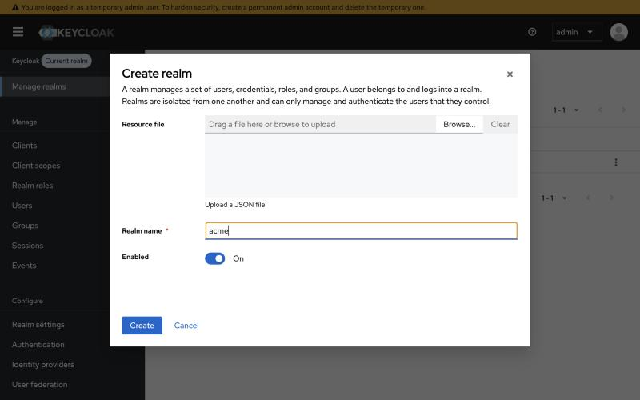
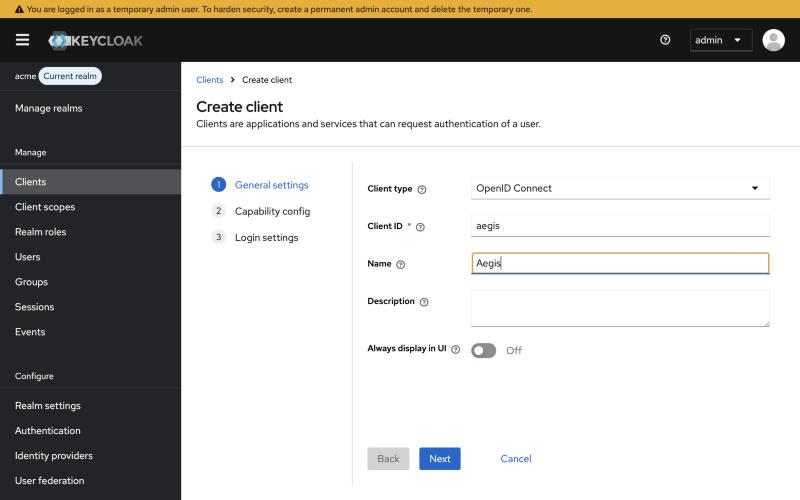
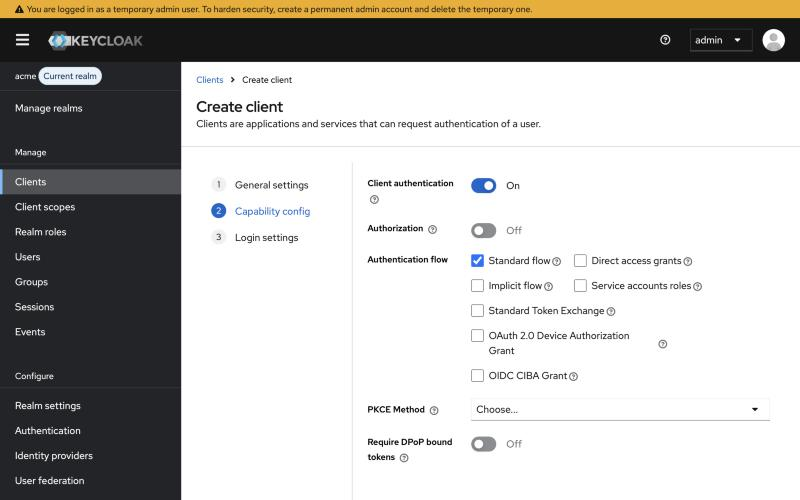
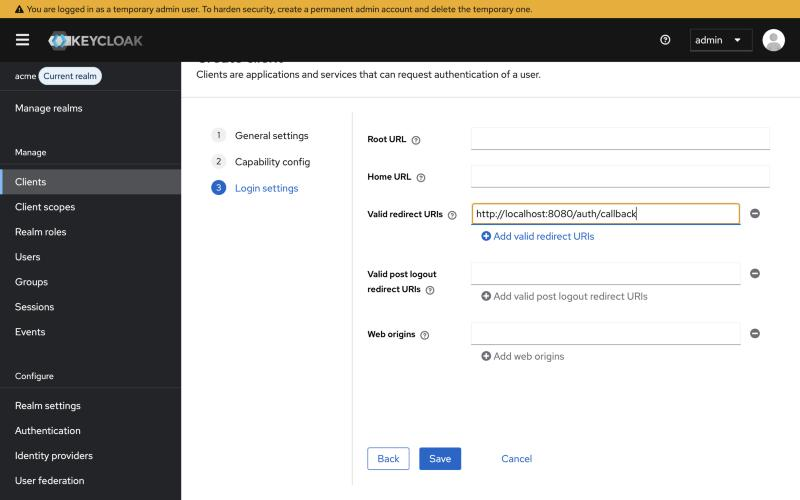
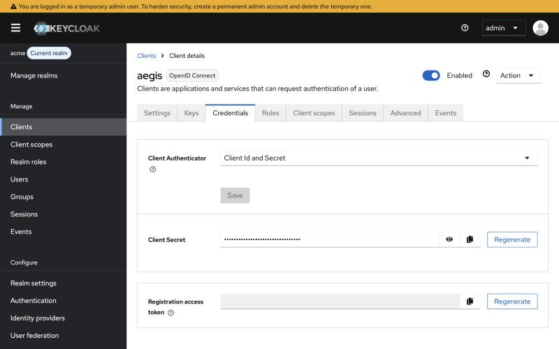
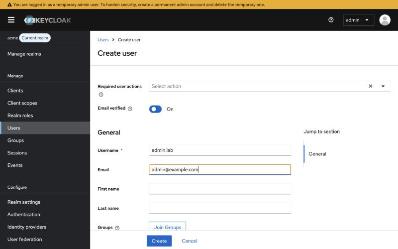
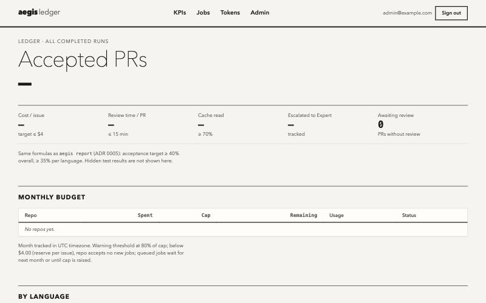
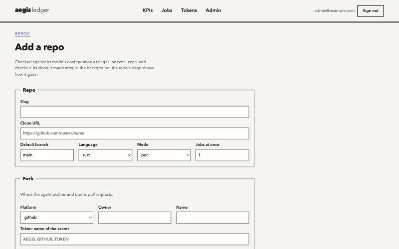

# Install Aegis on Premise: From a Blank Machine to the First PR

One path, start to end, for a first install with Docker Compose on one Linux machine (#404). Each step ends with a **Check** to pass before the next. Day-two work is in the [On-Premise Runbook](runbook/on-premise.md): upgrades, rollback, backups, the systemd variant, and troubleshooting.

Time: about an hour on the machine. Part A (accounts, tokens, SSO) is the longer part when other teams own these things, so start it first.

**What you end up with:** Aegis at `https://aegis.example.internal` behind your TLS proxy, sign-in through your SSO, one GitHub repo registered, and a draft PR opened by the agent for an issue labelled `aegis`.

Throughout, replace:

| Placeholder | Example | What it is |
| --- | --- | --- |
| `aegis.example.internal` | | The DNS name of the dashboard, the API and the webhooks |
| `acme/widget` | | The upstream repo whose issues Aegis fixes |
| `acme-aegis-bot` | | The bot account that pushes branches and opens PRs |
| `X.Y.Z` | `0.5.0` | The release, from the [Releases page](https://github.com/hoanghainh1188/aegis-code/releases), written without `v` |

---

## Part A: Before the Machine

### A1. A bot account and its fork

The agent never pushes to the upstream repo. It pushes `agent/*` branches to a fork and opens PRs there; maintainers merge from the fork ([Adding Repositories](runbook/repos.md#prerequisites) describes the alternative of PRs straight into upstream).

1. Create a GitHub account for the bot, e.g. `acme-aegis-bot`, with an email your team reads.
2. Signed in as the bot, fork `acme/widget`. Keep the fork's default branch the same as upstream's, and sync it regularly (GitHub: **Sync fork**).

**Check:** `https://github.com/acme-aegis-bot/widget` exists and says *forked from acme/widget*.

### A2. The fork token

Signed in as the bot: **Settings → Developer settings → Personal access tokens → Fine-grained tokens → Generate new token**.

| Field | Value |
| --- | --- |
| Resource owner | The bot (`acme-aegis-bot`) |
| Repository access | *Only select repositories*: `widget` (the fork) |
| Permissions | *Contents*: Read and write. *Pull requests*: Read and write |

Aegis also reads the upstream repo's issues and CI logs (*Issues* and *Actions*: Read) with this same token. For a **public** upstream, every token can read them, so the token above is enough.

For a **private** upstream, one token must reach both the bot's fork and the organization's upstream, which a fine-grained token cannot (it has one resource owner). Use instead a classic token of the bot with scope `repo`, after the organization has given the bot read access to `acme/widget`; or open PRs straight into upstream (`fork` = upstream, [Adding Repositories](runbook/repos.md#prerequisites)) with a fine-grained token owned by the organization.

Keep the value for step B5. It is sent on every clone, public repos included, so an invalid token fails registration (step C1).

### A3. The comment token

Aegis comments on the upstream issue when a job ends, and checks with this token that whoever asks for a review round may write to the repo. That needs a token with *Issues*: Read and write on `acme/widget`. A fine-grained token can only be given that on repos of its resource owner, so if `acme` is an organization: resource owner `acme`, repository `widget`, *Issues* Read and write (an organization admin may have to approve it). The bot can only make such a token if it is a member of the organization; otherwise use a maintainer's.

Without it, Aegis still opens PRs, but does not comment on issues, and review rounds asked for in comments are refused.

### A4. An OIDC client in your SSO

Aegis signs users in with OpenID Connect. It needs a **confidential** client (with a secret), the **authorization code** flow (Aegis uses PKCE), the scopes `openid email profile`, and an `email` claim. Mark emails **verified** if your SSO can: a role granted to an email *before* that person's first sign-in is attached only if the SSO says the email is verified, and otherwise their sign-in is refused. Granting *after* the first sign-in always works, so this guide does that (B9).

The screenshots are Keycloak 26 (realm `acme`, made for this guide in a lab, where Aegis was at `http://localhost:8080`; yours is `https://aegis.example.internal`).

1. **Manage realms → Create realm** (or use your existing realm).

   

2. **Clients → Create client.** *Client type*: OpenID Connect. *Client ID*: `aegis`.

   

3. **Next.** Turn on **Client authentication**. Keep **Standard flow** checked; nothing else is needed.

   

4. **Next.** *Valid redirect URIs*: `https://aegis.example.internal/auth/callback`, exactly. **Save.**

   

5. **Credentials** tab: copy the **Client Secret** for step B5.

   

6. Your users come from your directory. For a user made by hand (as here), turn on **Email verified** and give an email.

   

You now have: the **issuer** `https://<keycloak>/realms/<realm>`, the client ID `aegis`, and its secret.

**Other SSOs:**
- **Microsoft Entra ID:** an app registration with platform *Web* and the redirect URI above, plus a client secret. The issuer is `https://login.microsoftonline.com/<tenant-id>/v2.0`. Add the optional claim `email` to the ID token. Its ID token does not say the email is verified: grant roles only after each person has signed in once.
- **Okta:** an *OIDC Web Application* with grant type *Authorization Code*, the redirect URI above, and the issuer of your authorization server (`https://<org>.okta.com/oauth2/default`).

**Check:** `curl -s <issuer>/.well-known/openid-configuration` (for example `curl -s https://sso.example.internal/realms/acme/.well-known/openid-configuration`) returns JSON whose `issuer` is exactly the issuer you noted, trailing slash included.

### A5. A model

The default mode `poc` uses the Claude API: get an API key from the [Claude Console](https://console.anthropic.com/). For a local model (Ollama, vLLM) instead, see [config/local.toml](../config/local.toml) and the [Runbook](runbook/on-premise.md#1-installation--setup), step 2.

### A6. A name and a certificate

A DNS record `aegis.example.internal` pointing at the machine, and a TLS certificate for it, used by your reverse proxy (step B8). GitHub must reach `https://aegis.example.internal/webhooks/github` to send webhooks. If the machine is not reachable from the Internet, see [Webhooks Without Inbound Access](#webhooks-without-inbound-access).

If your SSO, GitHub Enterprise or GitLab uses a certificate from an **internal CA**, the server must trust that CA, or sign-in fails when the server first reads the issuer. See [step B6](#b6-env).

---

## Part B: The Machine

### B1. Linux, Docker and Compose

- **Machine:** Linux on **x86_64 or arm64**, at least 4 vCPUs, 16 GB RAM and 100 GB SSD, used only by Aegis. Docker pulls the image of your machine's architecture by itself. Releases up to 0.5.0 have `linux/amd64` images only; on arm64, use a later release (#405).
- **Docker:** Docker Engine 25 or newer and the Compose plugin v2, from [Docker's install guide](https://docs.docker.com/engine/install/) for your distribution.
- **Tools:** `git`, `openssl` and `curl`.

**Check:** `docker version --format '{{.Server.Version}}'` prints 25 or more, and `docker compose version` prints v2 or later.

### B2. The release

```bash
sudo git clone --branch vX.Y.Z --depth 1 https://github.com/hoanghainh1188/aegis-code /opt/aegis-code
cd /opt/aegis-code/deploy/compose
```

Every command below runs from this directory. The files belong to root: edit them with `sudo` (for example `sudoedit server.toml`).

### B3. Prepare the machine

```bash
sudo ./install.sh
```

It creates `/srv/aegis/.workspace` (owned by uid 10001, the image's user), `./secrets/` with the database password and URL, the session key and the GitHub webhook secret, a `.env`, and `server.toml` from the example. It never overwrites a file, so running it again is safe.

It then asks for the values of steps B4–B6 and B9 (#476). Have Part A at hand:

| Question | From | Step it does |
| --- | --- | --- |
| Sandboxes to pull | Your repos' languages | B6 |
| Public URL | A6 | B4 |
| OIDC issuer, client ID | A4 | B4 |
| Email of the first admin | Your SSO account. Leave it empty if your SSO does not mark emails verified (Entra ID, A4) | B9 |
| Claude API key, OIDC client secret, comment token (typed without echo) | A5, A4, A3 | B5 |

An empty answer skips that value; do its step by hand below, or run `./install.sh` again later, which asks only for what is still missing. To install without questions, give the values in the environment: see the [Runbook](runbook/on-premise.md#1-installation--setup), step 1.

**Check:** the last lines start with `Next (docs/runbook/on-premise.md):`, and `sudo ls secrets` lists `AEGIS_DATABASE_URL AEGIS_GITHUB_WEBHOOK_SECRET AEGIS_SESSION_KEY postgres_password`, plus the secrets you typed.

### B4. `server.toml`

`install.sh` set `public_url` and `[auth.oidc]` if you answered them; check them with `sudo grep -A2 -E '^public_url|^\[auth.oidc\]' server.toml`. Otherwise, edit `server.toml`. Change only these lines:

```toml
[auth]
public_url = "https://aegis.example.internal"
# 1: behind one reverse proxy (step B8). 0 if users reach port 8080 directly.
trusted_proxies = 1

[auth.oidc]                                    # remove the leading "# "
issuer = "https://sso.example.internal/realms/acme"
client_id = "aegis"
```

The rest (`[modes] poc`, workers, budgets) can stay as it is for a first install.

### B5. Secrets

`install.sh` wrote the secrets you typed in B3. The fork token (A2) is written in C1 by `add-repo.sh`. For a secret you skipped, or for C1 on the dashboard: one file per secret in `./secrets`, owned by uid 10001 and readable only by it. Aegis refuses to start if a secret file can be read by others. This helper reads the value from your terminal, so it stays out of your shell history. Paste it into **bash** (it does not work in zsh):

```bash
put_secret() {
  local value
  read -rsp "$1: " value; echo
  sudo sh -c 'umask 077; cat > "secrets/$1"; chown 10001:10001 "secrets/$1"' _ "$1" <<<"$value"
}
put_secret ANTHROPIC_API_KEY             # A5. Required: the server does not start without its mode's key
put_secret AEGIS_OIDC_CLIENT_SECRET      # A4
put_secret AEGIS_GITHUB_COMMENT_TOKEN    # A3 (optional)
put_secret AEGIS_TOKEN_WIDGET            # A2, named after the repo; used in step C1
```

**Check:** `sudo ls -l secrets` shows each file as `-rw------- 1 10001 10001`.

### B6. `.env`

`install.sh` set `AEGIS_SANDBOXES` from your answer. One line to add, and the first to check, in `.env`:

```bash
# Only the sandbox images of your repos' languages: python is always needed
# (it is also the gate's egress proxy). Others: go rust node java dotnet.
AEGIS_SANDBOXES="python go"
# Keep plain HTTP on this machine; the proxy (B8) serves HTTPS.
AEGIS_PUBLISH=127.0.0.1:8080
```

**Internal CA only.** The server trusts the image's CA bundle. Add your CA to a copy of it and mount the copy over it, with a file `docker-compose.override.yml` next to `docker-compose.yml` (Compose reads it too):

```bash
sudo docker run --rm --entrypoint cat ghcr.io/hoanghainh1188/aegis-server:X.Y.Z \
  /etc/ssl/certs/ca-certificates.crt | sudo tee ca-bundle.crt >/dev/null
sudo sh -c 'cat /path/to/your-ca.crt >> ca-bundle.crt'
sudo tee docker-compose.override.yml >/dev/null <<'YAML'
services:
  aegis:
    volumes:
      - ./ca-bundle.crt:/etc/ssl/certs/ca-certificates.crt:ro
YAML
```

Redo the bundle when you upgrade, so it keeps the new image's CAs.

### B7. Start

```bash
sudo ./aegis-deploy.sh X.Y.Z
```

It pulls the server and sandbox images of `X.Y.Z` from GHCR, starts PostgreSQL and Aegis, and waits until they are healthy. The database schema is created on the first start. The first pull takes a few minutes; the sandbox images are large.

**Check:** the last line is `aegis X.Y.Z healthy`, and:

```bash
curl -s http://127.0.0.1:8080/api/v1/health
# {"data":{"status":"ok"},"error":null,"meta":null}
```

If it is not healthy: `sudo docker compose logs aegis` names the missing secret or the wrong setting.

### B8. HTTPS

Put a reverse proxy in front of `127.0.0.1:8080`. With [Caddy](https://caddyserver.com/) and your certificate:

```caddy
aegis.example.internal {
    tls /etc/ssl/certs/aegis.crt /etc/ssl/private/aegis.key
    reverse_proxy 127.0.0.1:8080
}
```

For Nginx, see the [Runbook](runbook/on-premise.md#reverse-proxy-configuration-tls-termination).

**Check:** `curl -s https://aegis.example.internal/api/v1/health` returns the same JSON as in B7.

### B9. The first administrator

If you gave the admin email in B3, `aegis-deploy.sh` granted it admin as it started (it prints `admin: <email>`). Open `https://aegis.example.internal`, sign in through your SSO, and go to the **Check**. Otherwise:

1. Open `https://aegis.example.internal`. You are sent to your SSO, then back to the dashboard, signed in with no role yet.
2. Grant admin to the email shown at the top right:

   ```bash
   sudo docker compose exec aegis aegis-server --config /etc/aegis/server.toml grant you@example.com admin
   # you@example.com: admin = true
   ```

3. Reload the page.



**Check:** the menu has **Admin**. If sign-in fails instead:
- *SSO account has no email*: the SSO sends no `email` claim (A4).
- *…or SSO has not verified it*: this email was granted a role before its first sign-in, and the SSO does not say it is verified. Mark it verified in the SSO (A4, step 6).
- The browser gets an error page: `sudo docker compose logs aegis` shows the cause after `sign-in: discovery`. `Request failed` is usually a certificate the server does not trust (internal CA: B6). `unexpected issuer URI` means `issuer` in `server.toml` differs from what the SSO announces (A4, Check).

---

## Part C: The First Repo and the First Job

### C1. Register the repo

**First, check it** (optional, recommended for a pilot): `aegis check-repo` is in the server image. It runs the repo's gate once in a sandbox and says what would stop jobs (no lockfile, no sandbox image, tests that need a network). See the [Runbook](runbook/on-premise.md#before-registering-aegis-check-repo).

**From the machine** (#476), in `deploy/compose`:

```bash
sudo ./add-repo.sh
```

It asks for:
- the upstream URL (`https://github.com/acme/widget`), and the slug, branch, language and mode, each with a default;
- the fork (`acme-aegis-bot/widget`) and its token (A2, typed without echo);
- the emails of maintainers and reviewers. People granted before their first sign-in need an email the SSO marks verified (A4); otherwise leave them empty and use C2 after they have signed in;
- the monthly budget.

It writes the token as `secrets/AEGIS_TOKEN_WIDGET` and the repo file, registers and clones the repo, grants the roles, and prints the webhook settings of C3 and the link to the repo's budget page. Then go to the **Check** below, and to C3. Without questions, the values come from the environment ([Runbook](runbook/on-premise.md#2-registering-repositories)).

**Or on the dashboard:** **Admin** (the list of repos) → **Add a repo**.



| Field | Value |
| --- | --- |
| Slug | `widget` (used in branch names and on the dashboard) |
| Clone URL | `https://github.com/acme/widget` (upstream, not the fork) |
| Default branch, Language | As upstream. The language picks the sandbox image, which must be in `AEGIS_SANDBOXES` (B6): `python`, `rust`, `go`, `java`; `typescript` uses `node`, `csharp` uses `dotnet` |
| Mode | `poc` |
| Fork: Platform, Owner, Name | `github`, `acme-aegis-bot`, `widget` |
| Token: name of the secret | `AEGIS_TOKEN_WIDGET` (the file from B5) |

Further down, **Conventions** is free text added to the agent's instructions for this repo. Say how to run one test and where tests go; it is the setting that most improves results ([Adding Repositories](runbook/repos.md#registration-and-cloning), step 6).

Then **Add and clone**.

**Check:** the repo's page shows its clone as *ready*. *Failed* shows the end of git's output: `could not read Username for 'https://github.com'` means the token was refused (A2). Fix the secret file (a changed value is read again within 5 minutes, without a restart), then **Change this repo** → **Save and fetch** to clone again.

From the command line instead: write the same settings as a TOML file ([template](runbook/repos.md#registration-and-cloning), step 4) and run `aegis-server ... repo add` ([Runbook](runbook/on-premise.md#2-registering-repositories)).

### C2. Who may do what

`add-repo.sh` did this for the emails you gave it. For anyone else:

```bash
A="sudo docker compose exec aegis aegis-server --config /etc/aegis/server.toml"
$A grant dev@example.com widget maintainer     # starts and cancels jobs, sets budgets
$A grant reviewer@example.com widget reviewer  # reviews PRs on the dashboard
```

Each person signs in once first, as in B9.

**Check:** each command prints `<email>: <role> in widget`, and the repo's page lists the people and their roles.

### C3. The webhooks

`add-repo.sh` printed these values. This needs admin rights on `acme/widget`. On `acme/widget` (upstream): **Settings → Webhooks → Add webhook**.

| Field | Value |
| --- | --- |
| Payload URL | `https://aegis.example.internal/webhooks/github` |
| Content type | `application/json` |
| Secret | The output of `sudo cat secrets/AEGIS_GITHUB_WEBHOOK_SECRET` |
| Events | *Let me select individual events*: **Issues** and **Workflow runs** |

For review rounds (asking the agent for changes on its PR), add a second webhook with the same values on the **fork** (`acme-aegis-bot/widget`), with the events **Pull request reviews**, **Pull request review comments** and **Issue comments**.

**Check:** the repo's page → **Connection to the forge** shows each secret as *set*, and the upstream webhook's `ping` among the last webhooks. **Check now** confirms the fork token may push and the comment token may comment.

Instead of adding the webhooks by hand, an admin can let Aegis make them from that page, with a token given once (`[web] make_webhooks = true` in `server.toml`, off by default; [Adding Repositories](runbook/repos.md#webhook-configuration), step 9).

### C4. The first job

On `acme/widget`, create the label `aegis` if the repo does not have it (**Issues → Labels**). Pick a small bug whose issue says how to reproduce it, and add the label.

**Check:**
- **Webhook:** under *Recent Deliveries* the response is `202`.
- **Within seconds:** the job is on the dashboard (**Jobs**) and goes to `running`.
- **When it ends:** a draft PR from `acme-aegis-bot:agent/...` appears on the fork, with the reproduction test, the fix and the gate's results, and (with the comment token) a comment on the issue links to it. The job's page links to it too, and reviewers grade it there ([Reviewer Guide](reviewing.md)).

If the job stops early (`stopped_budget`, `stopped_steps`), its page and the issue comment say why.

---

## Webhooks Without Inbound Access

GitHub must open a connection to `/webhooks/github`. If the machine is only on an internal network:
- forward only that path from your edge proxy or API gateway; or
- skip webhooks and start jobs with the developer CLI: `aegis submit widget acme/widget#12` ([aegis](client.md)).

## Next

- [Reviewer Guide](reviewing.md) for reviewers, and [aegis](client.md) for developers.
- **Before real use**, set up from the [Runbook](runbook/on-premise.md): daily backups (§4), alert rules from `deploy/alerts/`, and a monthly budget per repo.
- Upgrades: back up first, then, with the new version `X.Y.Z` (the clone from B2 is shallow, so fetch the tag):

  ```bash
  sudo git fetch --depth 1 origin tag vX.Y.Z && sudo git checkout vX.Y.Z
  sudo ./aegis-deploy.sh X.Y.Z
  ```

  See the [Runbook](runbook/on-premise.md#3-upgrades--rollback), §3, for rollback.
