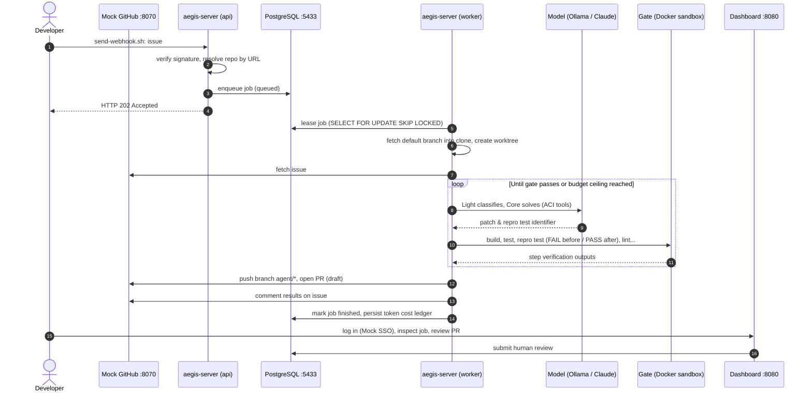

# Local End-to-End Walkthrough

Run the complete platform pipeline on a single workstation: issue labeled $\rightarrow$ webhook $\rightarrow$ queued job $\rightarrow$ agent synthesizes patch $\rightarrow$ gate verifies in sandbox $\rightarrow$ PR opened $\rightarrow$ comment posted to issue $\rightarrow$ human review on web dashboard. GitHub and SSO run locally as lightweight mock services; the sample repo is a small Go package with an intentional multi-byte string truncation bug. Requires zero external cloud accounts; running with Ollama is 100% free.

Runtime: ~30 minutes (excluding initial image downloads of ~2 GB and model weights of ~13 GB for Ollama).

## Prerequisites

| Requirement | Description |
| --- | --- |
| Rust stable (edition 2024) | Compiles `aegis-server`, `aegis-aci` |
| Docker Engine running | Runs PostgreSQL, mock SSO, gate sandboxes |
| `git`, `python3`, `openssl`, `curl` | Clones sample repo, mock GitHub server, signs HMAC webhooks |
| **One** of the two LLM options | See below |

**Model Selection:**

- **Ollama** (Default, `up.sh ollama`): Free, runs 100% locally; requires ~16 GB RAM for `gpt-oss:20b`. Slower (10–30 minutes per issue) with variable task success rates. Install [Ollama](https://ollama.com) and execute `ollama serve`.
- **Claude API** (`up.sh claude`): Significantly faster and more deterministic; typical cost: a few cents to a few dollars per issue (governed by job budget cap: `max_cost_usd = 2.0` in `scripts/trial/mode-claude.toml`). Requires `export ANTHROPIC_API_KEY=...`.

Port allocations: 5433 (PostgreSQL), 8070 (Mock GitHub), 8080 (Aegis Server), 8090 (Mock SSO), 9464 (Prometheus metrics).

---

## Workflow Architecture



---

## Step-by-Step Instructions

1. **Start Environment** (from repo root):

   ```bash
   scripts/trial/up.sh          # Default with Ollama
   # Or with Claude API:
   scripts/trial/up.sh claude
   ```

   The script verifies tools and port availability, compiles release binaries, builds `aegis-sandbox-go` if absent, (for Ollama) pulls `gpt-oss:20b`, and constructs `aegis-gpt-oss` with a 32k context window. It then initializes `.workspace/trial/`:
   - `env.sh`: Ephemeral test secrets generated randomly; server loads secrets via environment variables (`[secrets] source = "env"`);
   - PostgreSQL and Mock SSO ([mock-oauth2-server](https://github.com/navikt/mock-oauth2-server)), authenticating all logins as `dev@example.com` (`email_verified = true`);
   - Sample repository `upstream/demo` (contains `Truncate` function improperly splitting multi-byte runes) and `fork.git` target repo;
   - Mock GitHub service (`scripts/trial/fake_github.py`): serves issue #1, receives PRs and comments, includes a local web inspector;
   - Launches `aegis-server --role all`, registers repository `repo add demo.toml`, and grants `dev@example.com admin`.

2. **Trigger Issue Webhook** simulating GitHub labeling issue #1 with `aegis`:

   ```bash
   scripts/trial/send-webhook.sh
   ```

   Returns payload: `{"data":{"job_id":1,"status":"queued"},...}`.

3. **Monitor Execution:**
   - Server logs: `tail -f .workspace/trial/server.log` (JSON format, each line tagged with `job_id`).
   - Web Dashboard: <http://localhost:8080> (click login to enter). Displays live state, model calls, and token cost ledger.
   - Verification gate logs: `.workspace/trial/state/jobs/demo-org-demo-1-<run>/gate/logs/`.
   - Issue tracker: <http://127.0.0.1:8070/demo-org/demo/issues/1>.

4. **Review Generated PR:** Once completed, view the pull request at <http://127.0.0.1:8070/demo-org/demo/pull/100> (summary, reproduction proof, diff; mock GitHub numbers PRs starting at 100). Review and grade the PR on the web dashboard (job page $\rightarrow$ review). If the run terminates early (`stopped_budget`, `stopped_steps`), review explanations on the job page and issue comment.

5. **Automated Review Rounds (#243, #244):** Submit a "Request changes" review on PR 100 under username `reviewer` with inline review comments, then deliver a signed `pull_request_review` webhook:

   ```bash
   scripts/trial/send-review.sh 100 "Keep the cut on a rune boundary." textutil/textutil.go 9 "Explain why max <= 1 is special."
   ```

   The server resolves the original job for PR 100, confirms write permissions for `reviewer`, and schedules a `review` job. The agent resumes work on the existing PR branch, re-verifies against the gate, pushes a follow-up commit (no force-push), and responds to reviewer questions on the PR thread.

6. **Automated CI Failure Repair (#250):** Deliver a `workflow_run` failure webhook simulating a broken CI run on `main` (run 77 of mock GitHub):

   ```bash
   scripts/trial/send-ci-failure.sh
   ```

   The `ci` repair job inspects the failed step and trailing logs, synthesizes a fix on `main`, and opens a PR following standard verification gates.

7. **GitLab Pipeline Walkthrough (#252, #253, #254):** The trial includes `demo-gl`, a GitLab project fork. Simulate GitLab issue labeling:

   ```bash
   scripts/trial/send-gitlab-webhook.sh
   ```

   Inspect the opened merge request at <http://127.0.0.1:8070/demo-org/demo/-/merge_requests/1>.

8. **Environment Teardown:**

   ```bash
   scripts/trial/down.sh
   ```

   Terminates background services, removes temporary containers, and deletes `.workspace/trial/` including database volumes. Docker images and Ollama weights remain cached locally.

---

## Troubleshooting Trial Errors

| Symptom | Diagnostic Step |
| --- | --- |
| `up.sh: port ... is taken` | Previous session not cleaned up (`down.sh`), or existing service bound to port |
| `the server did not start` | Inspect `.workspace/trial/server.log`: missing secret or database startup failure |
| Webhooks return HTTP `401` | Ephemeral `env.sh` regenerated after server boot: run `down.sh` followed by `up.sh` |
| Job marked `rejected` with `no configuration for mode` or `no secret` | Verify `mode.toml` and `env.sh` inside `.workspace/trial/` |
| Immediate termination with model `404` | Ollama model missing: execute `ollama create aegis-gpt-oss -f scripts/trial/Modelfile` |
| Gate fails during initial step | Run `docker image inspect aegis-sandbox-go`; inspect step output in `gate/logs/` |

---

## Transitioning to Production

Production deployments connect to real forges (webhooks routed to `https://<domain>/webhooks/github`), read secrets from AWS Secrets Manager or secure local files, authenticate via enterprise OIDC SSO, and register real repository URLs. For full production instructions, see [AWS Runbook: Adding Repositories](runbook/README.md#6-adding-repositories) or [On-Premise Operations Runbook](runbook/on-premise.md).
