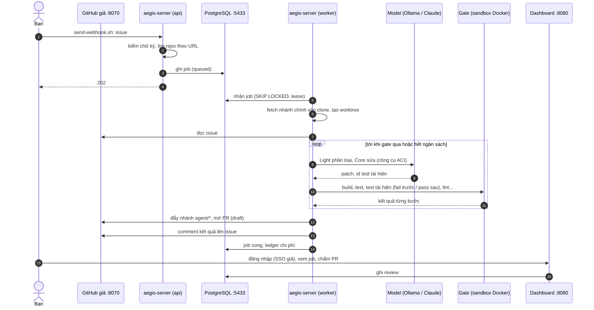

# Chạy thử end-to-end trên máy dev

Dựng cả luồng của platform trên một máy: issue được gắn nhãn → webhook → job trong hàng đợi → agent sửa → gate kiểm trong sandbox → PR → comment lên issue → chấm PR trên dashboard. GitHub và SSO là bản giả chạy tại chỗ; repo mẫu là một package Go nhỏ có sẵn bug. Không cần tài khoản cloud nào; với Ollama thì không tốn tiền.

Khoảng 30 phút, chưa tính thời gian tải image (~2 GB) và model (~13 GB với Ollama).

## Cần có

| | |
| --- | --- |
| Rust stable (edition 2024) | build `aegis-server`, `aegis-aci` |
| Docker đang chạy | PostgreSQL, SSO giả, sandbox của gate |
| `git`, `python3`, `openssl`, `curl` | repo mẫu, GitHub giả, ký webhook |
| **Một** trong hai model | xem dưới |

**Chọn model:**

- **Ollama** (mặc định, `up.sh ollama`): miễn phí, chạy trên máy; cần ~16 GB RAM cho `gpt-oss:20b`. Chậm (một issue 10–30 phút) và kết quả thất thường: có lần mở được PR, có lần dừng vì hết lượt gọi. Cài [Ollama](https://ollama.com) rồi `ollama serve`.
- **Claude API** (`up.sh claude`): nhanh và ổn định hơn nhiều; vài cent tới vài USD mỗi issue (trần của job: `max_cost_usd = 2.0` trong `scripts/trial/mode-claude.toml`). Cần `export ANTHROPIC_API_KEY=…`.

Cổng dùng: 5433 (PostgreSQL), 8070 (GitHub giả), 8080 (server), 8090 (SSO giả), 9464 (metric).

## Luồng



## Các bước

1. **Dựng** (từ gốc repo):

   ```bash
   scripts/trial/up.sh          # hoặc: scripts/trial/up.sh claude
   ```

   Script kiểm công cụ và cổng, build bản release, tạo image `aegis-sandbox-go` nếu chưa có, (Ollama) tải `gpt-oss:20b` và tạo `aegis-gpt-oss` với context 32k. Sau đó nó dựng mọi thứ trong `.workspace/trial/`:
   - `env.sh`: secret thử, sinh ngẫu nhiên; server đọc secret từ biến môi trường (`[secrets] source = "env"`), chỉ dành cho dev;
   - PostgreSQL và SSO giả ([mock-oauth2-server](https://github.com/navikt/mock-oauth2-server)), đăng nhập ai cũng thành `dev@example.com` với `email_verified = true`;
   - repo mẫu `upstream/demo` (`Truncate` cắt chuỗi theo byte, làm hỏng ký tự nhiều byte) và `fork.git`, nơi job đẩy nhánh;
   - GitHub giả (`scripts/trial/fake_github.py`): trả issue #1, nhận PR và comment, có trang xem PR và issue;
   - `aegis-server --role all`, rồi `repo add demo.toml` (đăng ký và clone) và `grant dev@example.com admin`.

2. **Gửi webhook** như GitHub gửi khi gắn nhãn `aegis` lên issue #1:

   ```bash
   scripts/trial/send-webhook.sh
   ```

   Trả về `{"data":{"job_id":1,"status":"queued"},…}`.

3. **Theo dõi:**
   - Log server: `tail -f .workspace/trial/server.log` (JSON, mỗi dòng của job có `job_id`).
   - Dashboard: <http://localhost:8080>, bấm đăng nhập là vào. Trang job có trạng thái, lượt gọi model, chi phí.
   - Log từng bước gate: `.workspace/trial/state/jobs/demo-org-demo-1-<số>/gate/logs/`.
   - Issue và comment: <http://127.0.0.1:8070/demo-org/demo/issues/1>.

4. **Kết quả:** job mở được PR thì xem ở <http://127.0.0.1:8070/demo-org/demo/pull/1> (mô tả và diff). Chấm nó trên dashboard (trang job → review). Job dừng (`stopped_budget`, `stopped_steps`…) thì lý do ở trang job và trong comment; với Ollama đây là chuyện thường, gửi lại webhook để chạy lần nữa.

5. **Dọn:**

   ```bash
   scripts/trial/down.sh
   ```

   Dừng server và GitHub giả, xóa hai container và `.workspace/trial/` (cả dữ liệu DB). Image Docker và model Ollama giữ lại.

## Khi có lỗi

| Hiện tượng | Xem |
| --- | --- |
| `up.sh: port … is taken` | Một lần thử trước chưa dọn (`down.sh`), hoặc dịch vụ khác giữ cổng |
| `the server did not start` | `.workspace/trial/server.log`: thiếu secret, DB chưa lên |
| Webhook trả `401` | `env.sh` đã đổi sau khi server chạy: chạy lại `down.sh` và `up.sh` |
| Job `rejected` `no configuration for mode` hoặc `no secret` | `mode.toml`, `env.sh` trong `.workspace/trial/` |
| Job dừng ngay với lỗi model `404` | Ollama chưa có `aegis-gpt-oss`: `ollama create aegis-gpt-oss -f scripts/trial/Modelfile` |
| Gate lỗi ở bước đầu | `docker image inspect aegis-sandbox-go`; log của bước trong `gate/logs/` |

## Khác với bản triển khai thật

Thật: GitHub thật (webhook ở `https://<domain>/webhooks/github`), secret trong Secrets Manager, SSO của công ty, repo đăng ký bằng URL thật. Cách đưa một repo thật vào dùng: [runbook, 6. Thêm repo](runbook/README.md#6-thêm-repo).
