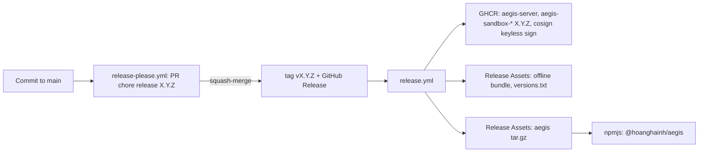

# Release Operations

A release `vX.Y.Z` bundles the server and sandbox container images on GHCR, offline bundles, and the developer client `aegis` (binaries and npm package) under a synchronized version (#263). The process follows modern GitOps standards: `release-please` manages versioning and changelogs, GitHub Releases trigger downstream pipelines, and npm packages are published via OIDC without storing long-lived npm tokens.



---

## Publishing a Release

1. **Merge Release PR:** When Conventional Commits land on `main`, `release-please` opens or updates a pull request titled `chore(release): aegis-code X.Y.Z`. `feat` increments minor version, `fix` increments patch; during `0.x`, breaking changes (`!`) also increment minor version. The PR updates versions across `Cargo.toml`, `Cargo.lock`, `npm/aegis/package.json`, `version.txt`, and generates `CHANGELOG.md`.
2. **Approve and Squash-Merge:** `release-please` automatically tags the repository and publishes a GitHub Release, triggering [.github/workflows/release.yml](../.github/workflows/release.yml):
   - `version`: Validates that tag matches versions across all manifests;
   - `images`: Builds and pushes 7 container images tagged `X.Y.Z` and `X.Y`, signed via Cosign keyless signing;
   - `offline`: Runs `docker save` for each image and attaches tarballs to the GitHub Release;
   - `client`, `publish-client`: Compiles binaries for four target architectures, builds npm package, and publishes to npmjs.
3. **Re-running Failed Release Jobs:** Actions $\rightarrow$ Release $\rightarrow$ *Run workflow* targeting the release tag. Artifact publishing steps are idempotent (`--clobber` for release assets, identical image tags). Note: npm rejects republishing an existing version.

---

## One-Time Setup

| Task | Configuration Surface |
| --- | --- |
| Secret `RELEASE_PLEASE_TOKEN`: Fine-grained PAT scoped strictly to this repo with Contents, Pull requests, and Issues Read/Write. Releases triggered by default `GITHUB_TOKEN` do not cascade to `release.yml` | Settings $\rightarrow$ Secrets and variables $\rightarrow$ Actions |
| Environment `npm-release` (optional required reviewers) | Settings $\rightarrow$ Environments |
| **Initial Manual npm Publish:** npm requires trusted publisher configuration on existing packages. Download `hoanghainh-aegis-X.Y.Z.tgz` from Release, run `npm login` as the npm user `hoanghainh` (the scope is the npm account, not the GitHub owner `hoanghainh1188`), then `npm publish hoanghainh-aegis-X.Y.Z.tgz --access public`. The automated `npm publish` step in `release.yml` will fail on this initial run; re-run after trusted publisher is configured | Operator workstation |
| Configure Trusted Publisher for package: Repository `hoanghainh1188/aegis-code`, workflow `release.yml`, environment `npm-release` | npmjs.com $\rightarrow$ package $\rightarrow$ Settings |
| Make GHCR Packages **Public** so users can pull without authentication | GitHub $\rightarrow$ Packages $\rightarrow$ each `aegis-*` $\rightarrow$ Package settings |

---

## Version Matrix

All components of a release share an identical version:

| Component | Identifier |
| --- | --- |
| Server | `ghcr.io/hoanghainh1188/aegis-server:X.Y.Z` |
| Gate Sandboxes | `ghcr.io/hoanghainh1188/aegis-sandbox-<python\|rust\|node\|java\|go\|dotnet>:X.Y.Z`; server calls these locally by bare names `aegis-sandbox-<profile>` |
| Client | `aegis-X.Y.Z-<target>.tar.gz`, npm `@hoanghainh/aegis@X.Y.Z` |
| Database | Final migration included in the release, documented in `versions.txt`; server runs migrations automatically on boot |

Server and sandboxes must run identical versions. The client supports backward compatibility, as `/api/v1` APIs are additive and non-breaking.

---

## Verifying Container Image Signatures

```bash
cosign verify ghcr.io/hoanghainh1188/aegis-server:X.Y.Z \
  --certificate-identity-regexp 'https://github.com/hoanghainh1188/aegis-code/.github/workflows/release.yml@.*' \
  --certificate-oidc-issuer https://token.actions.githubusercontent.com
```

Digest values for each image are recorded in `versions.txt` attached to the GitHub Release.

---

## Air-Gapped / Offline Environments

Download the following assets from the GitHub Release page on an Internet-connected workstation:
- Image tarballs `aegis-*-X.Y.Z.tar.gz` and their respective `.sha256` files (you may omit unused language sandboxes, except `sandbox-python` which serves as the egress proxy for gate fetch operations);
- Third-party dependencies bundle `aegis-dep-*.tar.gz` for Compose (`postgres:17-alpine`);
- `versions.txt` and `load-images.sh`.

Transfer all files to the target host and run:

```bash
./load-images.sh            # Validates SHA-256 checksums, loads docker images, tags sandboxes with bare names
```

Proceed with host deployment using [On-Premise Operations Runbook](runbook/on-premise.md), passing tag `X.Y.Z`.
