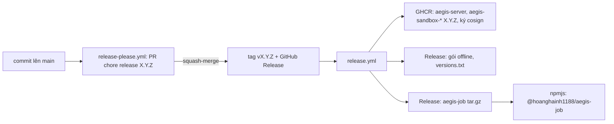

# Phát hành

Một bản phát hành `vX.Y.Z` gồm image server và image sandbox trên GHCR, gói offline, client `aegis-job` (binary và npm), cùng một version (#263). Cách làm theo komainu: release-please lo version và CHANGELOG, GitHub Release kích hoạt mọi bước phát hành, npm publish bằng OIDC nên không có token npm nào.



## Ra một bản

1. **Merge PR release.** Commit theo Conventional Commits vào `main` thì release-please mở hoặc cập nhật PR `chore(release): aegis-code X.Y.Z`. `feat` tăng minor, `fix` tăng patch; khi version còn `0.x`, thay đổi phá vỡ (`!`) cũng chỉ tăng minor. PR đổi version ở `Cargo.toml`, `Cargo.lock`, `npm/aegis-job/package.json`, `version.txt`, và viết `CHANGELOG.md`.
2. **Duyệt và squash-merge PR đó.** release-please tạo tag và GitHub Release, rồi [release.yml](../.github/workflows/release.yml) chạy:
   - `version`: tag phải khớp version ở cả ba file;
   - `images`: build và đẩy 7 image, tag `X.Y.Z` và `X.Y`, ký bằng cosign keyless;
   - `offline`: `docker save` từng image, gắn vào Release;
   - `client`, `publish-client`: binary cho bốn nền tảng, gói npm, publish.
3. **Chạy lại một bản lỗi giữa chừng:** Actions → Release → *Run workflow* với tag. Các bước đều ghi đè được: `--clobber`, cùng tag image. Riêng npm từ chối publish lại cùng một version.

## Thiết lập một lần

| Việc | Ở đâu |
| --- | --- |
| Secret `RELEASE_PLEASE_TOKEN`: fine-grained PAT chỉ cho repo này, quyền Contents, Pull requests, Issues đọc và ghi. Release do `GITHUB_TOKEN` tạo không kích hoạt `release.yml` | Settings → Secrets and variables → Actions |
| Environment `npm-release` (có thể thêm người duyệt) | Settings → Environments |
| **Lần publish npm đầu tiên làm bằng tay:** npm chỉ cấu hình được trusted publisher cho gói đã tồn tại. Tải `hoanghainh1188-aegis-job-X.Y.Z.tgz` từ Release, `npm login`, rồi `npm publish hoanghainh1188-aegis-job-X.Y.Z.tgz --access public`. Bước `npm publish` của `release.yml` sẽ lỗi ở lần đầu này: chạy lại sau khi cấu hình | máy của người phát hành |
| Trusted publisher cho gói: repo `hoanghainh1188/aegis-code`, workflow `release.yml`, environment `npm-release` | npmjs.com → gói → Settings |
| Image GHCR để **Public**, để khách kéo không cần đăng nhập (sau lần đẩy đầu) | GitHub → Packages → từng `aegis-*` → Package settings |

## Ma trận phiên bản

Mọi thành phần của một bản dùng cùng version:

| Thành phần | Tên |
| --- | --- |
| Server | `ghcr.io/hoanghainh1188/aegis-server:X.Y.Z` |
| Sandbox của gate | `ghcr.io/hoanghainh1188/aegis-sandbox-<python\|rust\|node\|java\|go\|dotnet>:X.Y.Z`; server gọi chúng bằng tên trần `aegis-sandbox-<profile>` |
| Client | `aegis-job-X.Y.Z-<target>.tar.gz`, npm `@hoanghainh1188/aegis-job@X.Y.Z` |
| Database | migration cuối của bản, ghi trong `versions.txt` của Release; server tự chạy migration khi khởi động |

Server và sandbox phải cùng version. Client thì khác version vẫn chạy được, vì API `/api/v1` chỉ thêm, không đổi.

## Kiểm image

```bash
cosign verify ghcr.io/hoanghainh1188/aegis-server:X.Y.Z \
  --certificate-identity-regexp 'https://github.com/hoanghainh1188/aegis-code/.github/workflows/release.yml@.*' \
  --certificate-oidc-issuer https://token.actions.githubusercontent.com
```

Digest của từng image có trong `versions.txt` của Release.

## Máy không ra được Internet

Tải từ trang Release về một máy có mạng:
- các file `aegis-*-X.Y.Z.tar.gz` cùng `.sha256` của chúng (mỗi image một file; có thể bỏ sandbox của ngôn ngữ không dùng, trừ `sandbox-python`, là proxy egress của gate);
- `aegis-dep-*.tar.gz`: image của bên thứ ba mà Compose chạy (`postgres:17-alpine`);
- `versions.txt` và `load-images.sh`.

Chép tất cả sang máy đích, rồi chạy:

```bash
./load-images.sh            # kiểm SHA-256 từng file, docker load, gắn tên trần cho sandbox
```

Sau đó dựng hệ thống theo runbook on-premise (#262), dùng đúng tag `X.Y.Z`.
