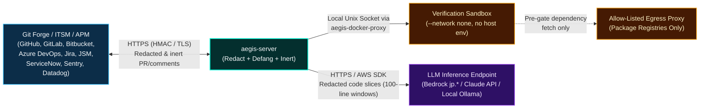

# Security & Compliance Overview (`aegis-code`)

This document consolidates the security architecture, data residency controls, isolation boundaries, and operational governance of **Aegis Platform (`aegis-code`)** for enterprise InfoSec, CISO, and compliance reviews. Every control summarized here is enforced in code and backed by its corresponding Architectural Decision Record (ADR) and operational runbook.

---

## 1. Core Security Principles

Aegis is designed around four non-negotiable invariants:

1. **Strict Human-in-the-Loop:** Aegis **never merges** pull requests, **never deploys** to any environment, and **never modifies** production data or configuration. Its sole code output is a Pull Request on an `agent/*` branch for human review ([Proposal §1](design/00-proposal.md#1-objectives--scope), [ADR 0011](adr/0011-ams-direction.md)).
2. **Untrusted Model (Confused-Deputy Architecture):** No prompt instruction makes an LLM immune to manipulation. Every authority boundary—file protection, lockfile locking, network isolation, secret redaction, and output sanitization—is enforced deterministically by the Rust platform outside the model ([ADR 0009](adr/0009-prompt-injection-threat-model.md)).
3. **Least-Privilege Execution:** Untrusted repository code and test suites execute inside hardened, network-isolated containers (`--network none`) mediated by a body-inspecting Docker API proxy ([ADR 0010](adr/0010-docker-socket-proxy.md)).
4. **Full Auditability & Kill-Switch:** Every administrative action, job state transition, model call, and token cost is recorded in PostgreSQL, and platform admins can halt all agents immediately without losing queued work ([Incident Runbook](runbook/incident.md)).

---

## 2. Data Flow & Data Residency

### What Leaves the Host Boundary

- **Bounded Code Context:** Aegis never uploads entire repositories to an LLM. The Agent-Computer Interface (`aegis-aci`) reads files in capped 100-line windows and caps search results to 50 entries ([Architecture §3](design/01-architecture-detail.md)).
- **Pre-Inference Secret Redaction:** All text sent to any model provider (issue bodies, code slices, CI logs, APM traces, gate output, recalled memory) passes through secret redaction (`aegis-gate/src/secrets.rs`).
- **Regional Data Residency (`customer-jp`):** Repositories configured under `customer-jp` enforce `ModelPolicy::JapanOnly` in `aegis-provider`: every model ID must carry the `jp.` inference profile prefix and route exclusively to **AWS Bedrock Tokyo (`ap-northeast-1`)**. The server refuses to start if a `customer-jp` mode configuration violates this guard.
- **Embedding Endpoint Residency (`[memory.embedding]`):** Embedding endpoints (`local`, `open_ai_compat`, `vertex_ai`, `bedrock`) are checked against `[residency]` (`allowed_regions` or `local_only`) just like chat providers, and all text is redacted before embedding. Under `customer-jp`, only Bedrock `ap-northeast-1` or `local` endpoints on the deployment's network are accepted; under `allowed_model_prefixes` alone (without `allowed_regions`), cloud embedding endpoints are rejected.
- **Air-Gapped / On-Premise Local Inference:** For environments that prohibit external model APIs entirely, Aegis supports local inference endpoints (`ProviderConfig::Local`, e.g., Ollama) alongside offline container image bundles ([Release Operations](release.md)).

---

## 3. Execution Isolation & Sandbox Hardening

Untrusted repository code, formatters, language servers, and test suites never execute directly on the host.

### 3.1. Container Hardening (`Hardening::args`)
Every verification gate container is launched with:
- **Network isolation:** `--network none` during test and verification steps.
- **Privilege drop:** `--cap-drop ALL`, `--security-opt no-new-privileges`, non-root numeric `uid:gid` (never `0`).
- **Filesystem & resources:** Read-only root filesystem (except explicitly allow-listed images such as Sonar scanner), `nosuid,nodev` tmpfs mounts, and explicit memory (no swap), CPU, and PID limits.
- **Zero host secrets:** Containers receive no host environment variables and no `.env` files.
- **Ephemeral Database Sidecars ([ADR 0013](adr/0013-ephemeral-database-sidecars.md)):** Repositories requiring PostgreSQL, Redis, or MySQL run declared sidecars on a temporary, internal-only Docker bridge (`aegis-sidecar-*`) with **no internet egress**, restricted to deployment-approved `--sidecar-image` values.
- **Optional gVisor (`runsc`) Runtime:** Operators can configure an alternative OCI runtime (such as gVisor `runsc`) for stronger kernel isolation; empirical overhead benchmarks are documented in [gVisor Measurement](measurements/2026-11-16-gvisor-runsc.md).

### 3.2. Docker Socket Filtering Proxy (`aegis-docker-proxy`, [ADR 0010](adr/0010-docker-socket-proxy.md))
The `aegis-server` process never holds direct access to `/var/run/docker.sock`. All container operations pass through a dedicated Rust proxy (`aegis-docker-proxy`) that:
- Runs as non-root (`uid 10001`), with no network, read-only rootfs, and no capabilities.
- Allows only the minimal Docker API routes required for Aegis-prefixed containers (`aegis-gate-*`, `aegis-egress-*`, `aegis-format-*`, `aegis-lsp-*`, `aegis-sidecar-*`) and refuses `exec`, `build`, `archive`, `volumes`, `swarm`, or calls targeting non-Aegis containers.
- **Rebuilds JSON request bodies from scratch** (preventing Go `encoding/json` case-insensitivity and duplicate-key bypasses) and rejects Docker API versions older than `1.44`.
- **Validates bind mounts after symlink resolution** against `--mount-root` so a malicious symlink inside a repository cannot mount host paths.
- On **Kubernetes** ([ADR 0008](adr/0008-gate-sandbox-on-kubernetes.md)), runs as a native sidecar alongside a DinD sidecar inside dedicated worker node pools.

---

## 4. Prompt Injection Defense & Output Integrity

Aegis treats every external input—issues, PR review comments, CI logs, Jira/JSM/ServiceNow tickets, Sentry/Datadog telemetry, repository docs, and recalled memory—as **untrusted data** ([ADR 0009](adr/0009-prompt-injection-threat-model.md)).

| Defense Layer | Mechanism | Enforcement Point |
| :--- | :--- | :--- |
| **Input Isolation** | Every untrusted input undergoes secret redaction (`redact`), XML/platform tag neutralization (`defang`), and explicit data framing before reaching the prompt. | `aegis-lifecycle`, `aegis-provider` |
| **Embedded Instruction Detection** | The platform scans inputs read by the agent for prompt-injection-like directives and surfaces them as a platform-authored callout in the PR body (measured at 1 false positive per ~1M clean lines, [report](measurements/2026-11-12-injection-flags.md)). | `aegis-lifecycle` |
| **Protected Files (`ALWAYS_PROTECTED`)** | CI workflows (`.github/workflows/**`, `.gitlab-ci.yml`), `CODEOWNERS`, Sonar, linter, coverage, and test-runner configs are blocked in code across all profiles. | `aegis-gate`, `aegis-lang` |
| **Inert Model Output (`inert()`)** | All model-authored fields in PR descriptions, commit messages, review replies, and diagnosis reports are stripped of bidi controls, Markdown links/images, HTML tags, entities, `@mentions`, and `#issue` references so output cannot exfiltrate data via browser fetches or trigger unintended pings/closures. | `aegis-pr/src/body.rs` |
| **Checked-Source Grounding** | Before opening a PR or publishing a diagnosis, cited file/line evidence is verified against the repository tree; unverifiable citations are rejected and block PR creation. | `aegis-lifecycle/src/answer.rs` |
| **Empirical Injection Evaluation** | Tested across issues, READMEs, code comments, CI logs, docs, and review notes with **0/18** payload executions ([eval suite](../eval/injection/README.md)). | `eval/injection/` |

---

## 5. Identity, Secrets, Secret Scanning & Tenant Isolation

### 5.1. Authentication & Authorization
- **SSO via OIDC (PKCE):** Dashboard users authenticate through corporate OIDC IdPs (Authorization Code + PKCE, single-use state/nonce stored in PostgreSQL, `__Host-` `HttpOnly` cookies, automatic JWKS key rotation handling).
- **Scoped API Tokens:** Developers and CI pipelines authenticate via personal or service tokens (stored hashed in PostgreSQL).
- **Role-Based Access Control (RBAC):** Per-repository roles (`reviewer`, `maintainer`) plus tenant-level and platform-level `admin` roles. Review rounds (`/aegis fix`) are accepted only from users with repository write permissions.
- **Webhook Verification:** All incoming webhooks (GitHub, GitLab, Bitbucket Cloud, Bitbucket Data Center, and Azure DevOps service hooks) require valid signatures or secrets (`X-Hub-Signature-256`, `X-Gitlab-Token`, `X-Hub-Signature`, or Basic auth / `X-Aegis-Webhook-Secret`) checked in constant time and are protected by rate limiting and deduplication (`webhook_deliveries`).

### 5.2. Secret Lifecycle & GitHub App
- **Live Secret Rotation (`aegis-secrets`):** Secrets are loaded from AWS Secrets Manager, on-premise permission-checked secret files (`0600`, no world-writable state directories), or environment variables, and are re-read at use time so rotation requires **no server restart** ([AWS Runbook §3](runbook/README.md#3-secret-rotation)).
- **GitHub App Short-Lived Tokens ([ADR 0017](adr/0017-github-app.md)):** The recommended GitHub integration mints short-lived, repository-scoped installation tokens via RS256 App JWTs (≤ 10 min TTL), eliminating long-lived bot PATs. The App is registered **without** the `workflows` permission so GitHub itself refuses any push modifying `.github/workflows/`.
- **Outbound & Patch Secret Scanning:** The gate includes a dedicated `secrets` step that fails any patch introducing credentials or tokens (reporting file, line, and kind—never the secret value; test fixtures require explicit `[[secrets.allow]]` exceptions with a documented reason). Every outbound commit message, PR body, and tracker comment is redacted prior to transmission and counted via `aegis_secrets_blocked_total`.

### 5.3. Multi-Tenant / Contract Isolation ([Tenants Runbook](runbook/tenants.md))
When operating multiple contracts on one instance, each tenant isolates:
- **Access:** Tenant admins have permissions strictly within their tenant's repositories.
- **Secrets:** Non-default tenants may reference only secrets prefixed with `<TENANT>_` (enforced at registration/update).
- **Disk:** Clones, worktrees, AST maps, and build caches live under `<state_dir>/tenants/<id>/`.
- **Budgets & Concurrency:** Per-tenant monthly USD caps, per-tenant `max_concurrent_jobs`, and fair-share SLA queue scheduling prevent noisy-neighbor exhaustion.

---

## 6. Supply Chain Security & Controlled CVE Remediation

- **Locked Dependencies in Bug-Fix Jobs ([ADR 0015](adr/0015-cve-remediation-lane.md)):** Standard bug-fix and review-round jobs run under `DependencyPolicy::Locked`. Any unauthorized version bump, downgrade, or removal in a lockfile or resolved dependency tree fails the verification gate.
- **Allow-Listed Pre-Gate Fetch:** Dependency resolution runs before the air-gapped gate through an egress proxy restricted strictly to official package registries configured per language profile.
- **Dedicated CVE Remediation Lane:** Vulnerability upgrades run in a separate `cve` job mode initiated only by a repository maintainer (never parsed from untrusted issue text). The **platform** executes the profile's deterministic upgrade command behind the egress proxy, verifies checksums, licenses, and advisories, and invokes the agent **only** to adapt application code if the upgrade introduces breaking changes.
- **Platform Dependency Hygiene:** Aegis itself enforces `cargo deny check` in CI across all Rust dependencies (blocking yanked crates, unmaintained crates, unknown registries, and non-permissive licenses; see [deny.toml](../deny.toml)).
- **Offline Bundle SBOMs & Checksums:** Each release offline bundle ships per-image SPDX SBOMs (`<file>.spdx.json` generated by `syft` with `AEGIS_SBOM=1` in release builds) and a `SHA256SUMS-<arch>.txt` manifest covering every file in the bundle, alongside per-file `.sha256` files ([Release Operations](release.md)).

---

## 7. Auditability, Cost Controls & Incident Response

- **Immutable Audit Trail:** All administrative and lifecycle actions (repo/tenant changes, role grants, secret-prefix checks, pauses, memory edits, job cancellations) are recorded in PostgreSQL `audit_log` with actor identity, target, and JSON details, viewable at `/admin/audit`.
- **Financial & Runaway Circuit Breakers:** Every model call is recorded in `aegis-ledger`. Jobs halt automatically upon hitting the per-job cost cap (default `$4`), the per-language call cap (`40` calls; `80` for Rust, [ADR 0014](adr/0014-per-language-call-cap.md)), or consecutive Expert-tier failures, alongside monthly repo and tenant budget caps.
- **Global Kill-Switch ([Incident Runbook](runbook/incident.md)):** Platform admins can pause all agents via the dashboard (`/admin/pause`), API (`POST /api/v1/admin/pause`), or CLI (`aegis-server pause-all`) at two levels:
  - `intake`: Stops claiming queued jobs while letting active jobs finish.
  - `emergency`: Stops claiming **and** cancels all running jobs at their next lease renewal (~20s) while removing their containers.
- **Observability & Alerts:** Prometheus metrics (`:9464/metrics`) and pre-configured Alertmanager rules (`deploy/alerts/`) monitor pause state, secret-block events, queue stalls, consecutive gate failures, and budget thresholds.

---

## 8. Residual Risks & Hardening Roadmap

In line with transparent enterprise security engineering, the following residual risks are explicitly tracked:

| Residual Risk | Current Mitigation | Planned Hardening |
| :--- | :--- | :--- |
| **Shared Host Kernel (`runc` default)** | `--cap-drop ALL`, `no-new-privileges`, read-only rootfs, `--network none`, dedicated worker nodes. | Enable gVisor (`runsc`) per deployment/tenant where compliance requires user-space kernel isolation ([measurement](measurements/2026-11-16-gvisor-runsc.md)). |
| **Mount-Check TOCTOU Window in `aegis-docker-proxy`** | Workspace access restricted to `aegis` service user; non-world-writable state directory enforced at startup. | Rootless Docker or dedicated worker hosts separated from API nodes ([ADR 0010](adr/0010-docker-socket-proxy.md)). |
| **Pattern-Based Secret Redaction** | Comprehensive regex/pattern rules + gate `secrets` step + human PR review. | Entropy-based detection for unstructured secrets. |
| **Upstream `openidconnect` → `rsa` Advisories** | `RUSTSEC-2023-0071` and `RUSTSEC-2026-0387` are ignored in `deny.toml` because Aegis uses RSA **only** for public-key ID-token signature verification (never private-key decryption/signing). | Tracked in [#606](https://github.com/hoanghainh1188/aegis-code/issues/606) to remove ignores once upstream `openidconnect` updates. |
| **Single Global OIDC IdP** | Sufficient for single-organization self-hosted deployments. | Per-tenant OIDC configuration for multi-organization shared deployments. |

---

## 9. References

- [ADR 0007: On-Premise Deployment](adr/0007-on-premise-deployment.md)
- [ADR 0008: Gate Verification Sandboxes on Kubernetes](adr/0008-gate-sandbox-on-kubernetes.md)
- [ADR 0009: Prompt Injection Threat Model](adr/0009-prompt-injection-threat-model.md)
- [ADR 0010: Docker Socket Filtering Proxy](adr/0010-docker-socket-proxy.md)
- [ADR 0013: Ephemeral Database Sidecars](adr/0013-ephemeral-database-sidecars.md)
- [ADR 0015: CVE Remediation Lane](adr/0015-cve-remediation-lane.md)
- [ADR 0017: GitHub App Integration](adr/0017-github-app.md)
- [Incident Runbook: Pausing Every Agent](runbook/incident.md)
- [Tenants Runbook](runbook/tenants.md)
- [AWS Production Runbook (Secret Rotation & Isolation)](runbook/README.md)
- [Vulnerability Reporting Policy](../SECURITY.md)
